# اندیشکده کشتی ایران — کیوسک سلف‌سرویس

[](https://github.com/daneshavaran123-lab/andishkadeh/actions/workflows/apps.yml)

سامانه فروش خدمات و اشتراک برای کیوسک ۴۳ اینچ عمودی (لمسی، کارتخوان بانکی، اسکنر QR و چاپگر حرارتی) به‌همراه پنل مدیریت تحت وب و سرور مرکزی.

برنامه کیوسک **سه نسخه با یک رابط و یک هسته مشترک** دارد:

| نسخه | فناوری | خروجی |
| --- | --- | --- |
| ویندوز | Electron | نصب‌کننده `AndishkadehKiosk-Setup-<نسخه>.exe` |
| وب‌اپ | PWA | `http(s)://<سرور>/kiosk/` |
| اندروید | Capacitor | فایل APK |

## فهرست

1. [امکانات](#امکانات)
2. [معماری کلی](#معماری-کلی)
3. [سه نسخه کیوسک](#سه-نسخه-کیوسک)
4. [مسیر مشتری در کیوسک](#مسیر-مشتری-در-کیوسک)
5. [پرداخت امن و بازیابی](#پرداخت-امن-و-بازیابی)
6. [همگام‌سازی و حالت آفلاین](#همگامسازی-و-حالت-آفلاین)
7. [تنظیمات دستگاه](#تنظیمات-دستگاه)
8. [نمودارهای فعالیت UML](#نمودارهای-فعالیت-uml)
9. [راه‌اندازی محیط توسعه](#راهاندازی-محیط-توسعه)
10. [دستورها](#دستورها)
11. [ساخت خروجی‌ها و CI](#ساخت-خروجیها-و-ci)
12. [تست‌ها](#تستها)
13. [ساختار مخزن](#ساختار-مخزن)
14. [مستندات](#مستندات)

## امکانات

- **کیوسک**:
  - خرید یک یا چند خدمت از حوزه‌های مختلف با یک پرداخت
  - خرید اشتراک کامل و دریافت کارت عضویت QR
  - بررسی اعتبار اشتراک با اسکن QR
  - ادامه فروش خدمات در قطع شبکه (آفلاین) و همگام‌سازی بعدی
- **پنل مدیریت**:
  - داشبورد، گزارش فروش و خروجی Excel/CSV
  - سفارش‌ها، پرداخت‌ها (استعلام و تطبیق دستی)، اشتراک‌ها
  - خدمات و تعرفه‌ها، حوزه‌ها، پلن‌ها، تخفیف‌ها با پیش‌نمایش
  - رسانه‌ها، محتوای کیوسک، کیوسک‌ها و تجهیزات، همگام‌سازی، تنظیمات، کاربران و نقش‌ها، سوابق تغییرات
  - قابل نصب به‌عنوان برنامه در Chrome/Edge
- **سرور**: مرجع نهایی قیمت، سفارش، پرداخت و اشتراک. API کیوسک و پنل، احراز هویت دستگاه و مدیر، RBAC، OpenAPI.
- **بدون رزرو**: طبق سند، هیچ صفحه، لینک یا endpoint رزرو و نوبت‌دهی وجود ندارد (تست T15).

## معماری کلی

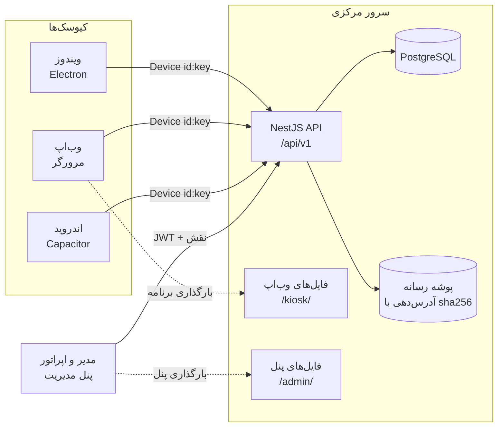

- **قراردادها در یک جا**: همه درخواست‌ها و پاسخ‌ها در `packages/shared/src/contracts` با zod تعریف شده‌اند. سرور، کیوسک و پنل نوع‌ها را از همان‌جا می‌گیرند و OpenAPI هم از همین تعریف‌ها ساخته می‌شود.
- **پول**: عدد صحیح تومان. قیمت و تخفیف هر قلم در لحظه قفل سفارش snapshot می‌شود.
- **موتور قیمت** (`packages/shared/src/pricing.ts`) در سرور و کیوسک یکسان اجرا می‌شود. اگر پیش‌نمایش کیوسک با سرور فرق کند، مشتری پیش از پرداخت مطلع می‌شود.
- **تقویم**: نمایش جلالی و مرز روز بر اساس `Asia/Tehran`.

جزئیات بیشتر: [معماری، مدل داده و نمودارهای وضعیت](docs/architecture.md).

## سه نسخه کیوسک

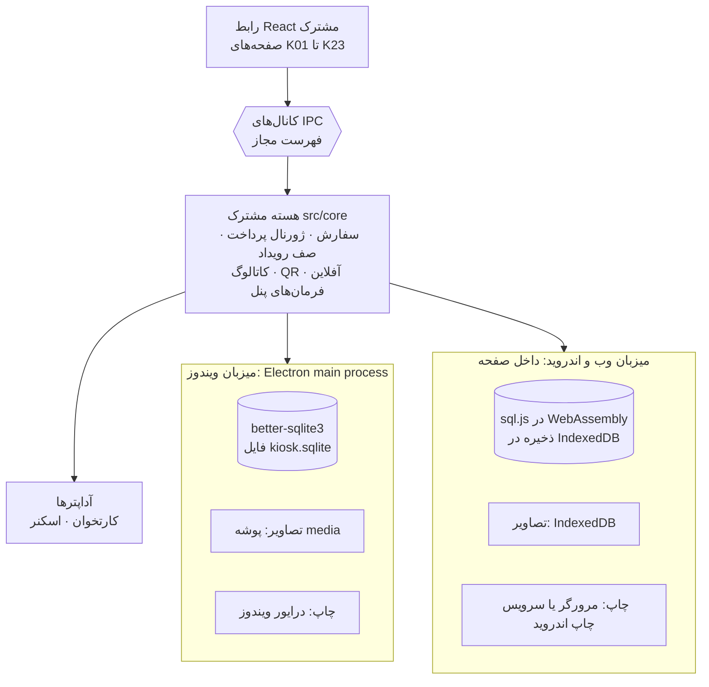

| | ویندوز | وب‌اپ | اندروید |
| --- | --- | --- | --- |
| محل اجرای هسته | فرایند اصلی Electron، جدا از رابط | داخل صفحه | داخل WebView برنامه |
| پایگاه محلی | فایل SQLite (WAL، `synchronous=FULL`) | SQLite در WebAssembly، ذخیره در IndexedDB | مانند وب‌اپ |
| پیکربندی | صفحه راه‌اندازی در اجرای اول، سپس `kiosk.config.json` و متغیرهای `KIOSK_*` | صفحه راه‌اندازی تکنسین | صفحه راه‌اندازی تکنسین |
| چاپ رسید | درایور ویندوز، بی‌صدا | چاپ مرورگر (با `--kiosk-printing` بی‌صدا) | سرویس چاپ اندروید |
| اسکنر QR | USB HID (حالت صفحه‌کلید) | USB HID | USB HID با OTG |
| قفل کیوسک | Assigned Access / Shell Launcher | حالت kiosk مرورگر | Lock Task با مدیریت دستگاه، یا App pinning |

راهنمای کامل هر نسخه: [ویندوز](docs/windows-kiosk-install.md) · [وب‌اپ و اندروید](docs/kiosk-platforms.md).

## مسیر مشتری در کیوسک

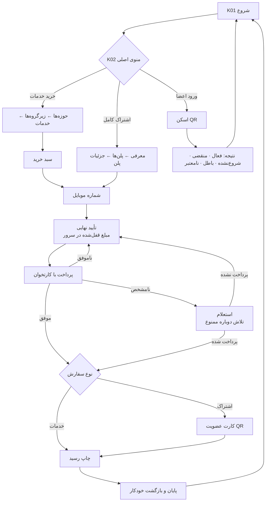

- مهلت بی‌فعالیتی هر صفحه با هشدار شمارش معکوس، نشست را پاک می‌کند (به‌جز هنگام پرداخت و چاپ، مگر وقتی این صفحه‌ها خطا نشان می‌دهند). سفارش قفل‌شده پرداخت‌نشده لغو می‌شود و پاسخی که پس از پایان نشست برسد نمایش داده نمی‌شود.
- موبایل همیشه ماسک‌شده نمایش داده می‌شود و QR خام در پایان نشست از کیوسک پاک می‌شود.

## پرداخت امن و بازیابی

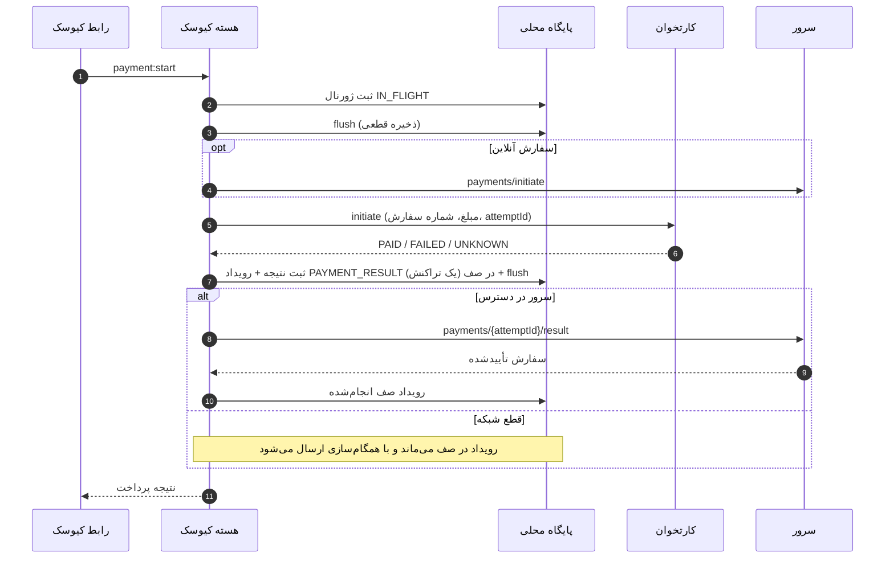

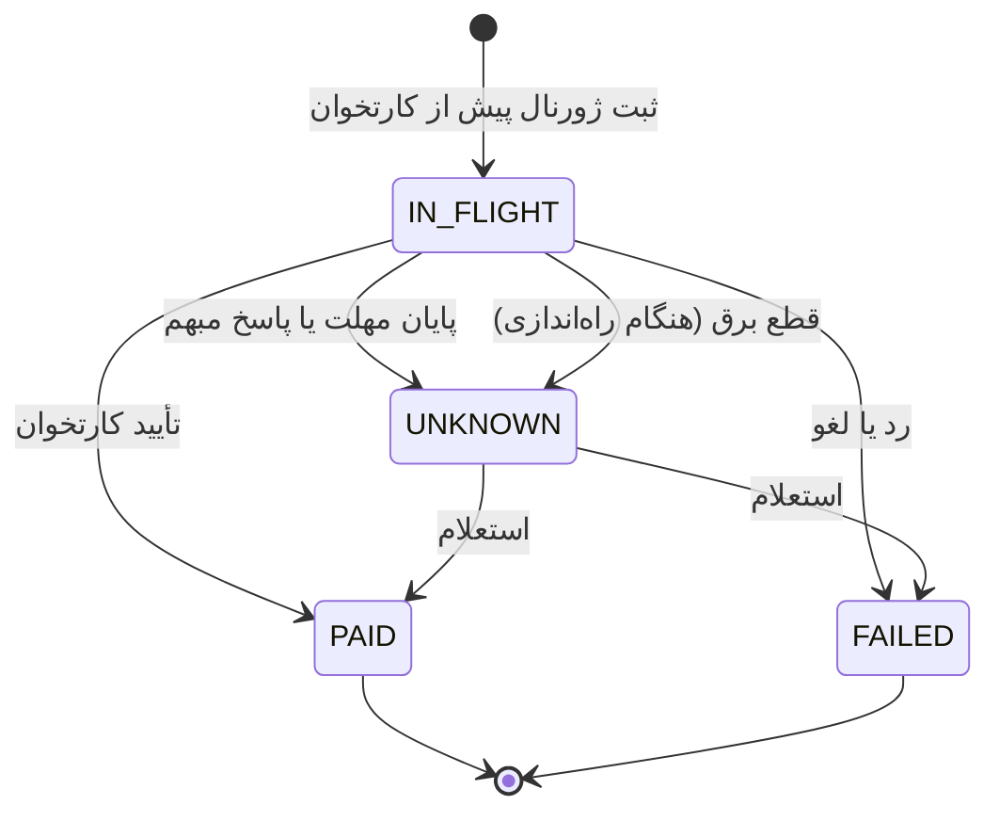

- هر سفارش فقط **یک تلاش فعال** دارد. تا وضعیت UNKNOWN روشن نشده، تلاش دوباره ممکن نیست.
- استعلام خودکار در شروع برنامه و هر `recoverySec` انجام می‌شود. از پنل هم «استعلام» یا «تطبیق دستی مستند» ممکن است.
- مبلغ نامشخص تا تعیین وضعیت در فروش قطعی شمرده نمی‌شود.
- اطلاعات کارت (PAN/CVV) هرگز خوانده، ذخیره یا ثبت نمی‌شود.

## همگام‌سازی و حالت آفلاین

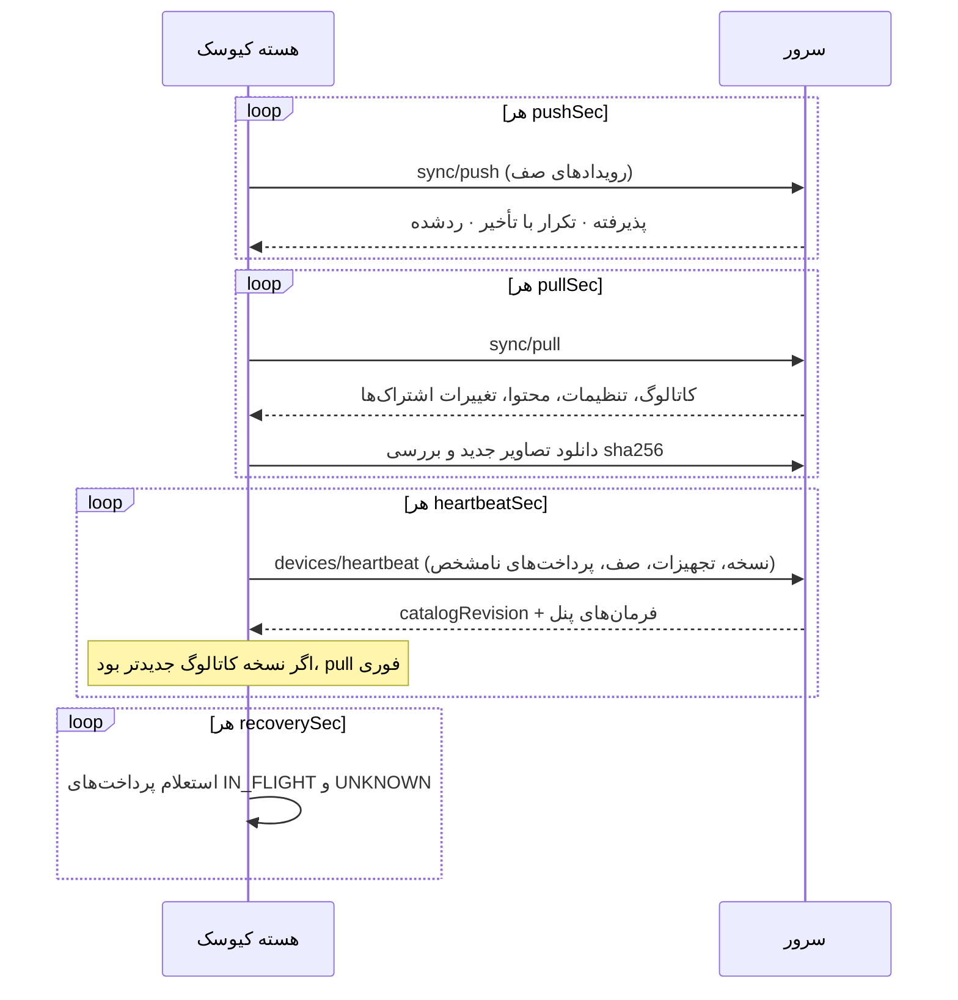

- **ارسال همیشه پیش از دریافت** است. هر رویداد `eventId` یکتا دارد و سفارش آفلاین با `(deviceId, localId)` ثبت می‌شود؛ ارسال دوباره هرگز سفارش تکراری نمی‌سازد.
- **فروش آفلاین**: فقط اگر سیاست مرکز اجازه دهد و کاتالوگ ذخیره‌شده از `offlineCatalogMaxAgeHours` قدیمی‌تر نباشد. شماره سفارش آفلاین `OFF-<دستگاه>-<شماره>` است.
- **بررسی QR آفلاین**: از کش اشتراک‌های همان کیوسک، با همان قواعد سرور. نتیجه برای ثبت در سرور در صف می‌ماند.
- **تصاویر**: تصویر جدید فقط پس از دانلود و بررسی sha256 جایگزین می‌شود. اگر دانلود نشد، تصویر قبلی می‌ماند.

## تنظیمات دستگاه

تنظیمات کیوسک در سه لایه نگهداری می‌شود:

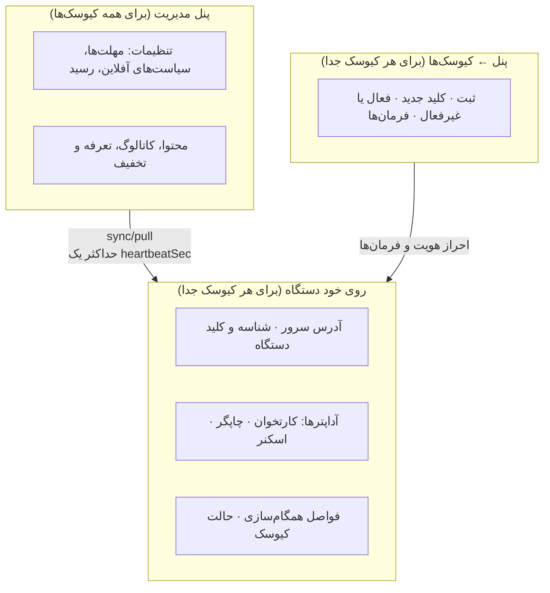

| لایه | کجا تغییر می‌کند | چه کسی | چه زمانی اعمال می‌شود |
| --- | --- | --- | --- |
| پیکربندی محلی دستگاه | ویندوز: صفحه راه‌اندازی در اجرای اول، سپس `kiosk.config.json`. وب و اندروید: صفحه راه‌اندازی | تکنسین | پس از اجرای دوباره برنامه |
| تنظیمات مرکز | پنل ← «تنظیمات» | فقط مدیر اصلی (ثبت در سوابق تغییرات) | همه کیوسک‌ها، در اولین heartbeat یا pull (به‌طور پیش‌فرض حداکثر ۳۰ ثانیه) |
| ثبت و کلید دستگاه | پنل ← «کیوسک‌ها» | فقط مدیر اصلی | فوری (کلید باطل‌شده درخواست بعدی را رد می‌کند) |

### ۱. چرخه عمر یک دستگاه

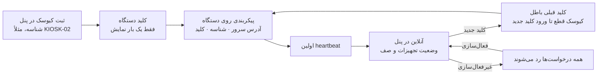

1. در پنل ← «کیوسک‌ها» گزینه «ثبت کیوسک جدید» را بزنید و شناسه و نام بدهید.
2. **کلید دستگاه فقط یک بار نمایش داده می‌شود**. سرور فقط هش sha256 آن را نگه می‌دارد و مقایسه را با زمان ثابت انجام می‌دهد. اگر کلید گم شد، «کلید جدید» بسازید.
3. کلید را روی دستگاه وارد کنید (بخش‌های ۲ و ۳ پایین).
4. با اولین heartbeat، دستگاه در پنل «آنلاین» می‌شود. دستگاهی که **۲ دقیقه** heartbeat نفرستد «قطع ارتباط» نمایش داده می‌شود.

### ۲. ویندوز: صفحه راه‌اندازی و `kiosk.config.json`

در اجرای اول، چون فایل پیکربندی وجود ندارد، صفحه «راه‌اندازی کیوسک» باز می‌شود. تکنسین این‌ها را وارد می‌کند:
- آدرس سرور، شناسه و کلید
- کارتخوان، چاپگر و اسکنر
- چاپگر رسید، از فهرست چاپگرهای ویندوز

برنامه کلید را با سرور بررسی می‌کند، فایل را می‌سازد و دوباره اجرا می‌شود. تغییرات بعدی در خود فایل انجام می‌شود.

فایل در پوشه داده برنامه قرار می‌گیرد: `%APPDATA%\AndishkadehKiosk\kiosk.config.json` (یا مسیر متغیر `KIOSK_DATA_DIR`). نمونه کامل: [`apps/kiosk/kiosk.config.example.json`](apps/kiosk/kiosk.config.example.json).

```json
{
  "serverUrl": "https://kiosk-api.example.ir",
  "deviceId": "KIOSK-01",
  "deviceKey": "کلید دستگاه از پنل مدیریت",
  "adapters": { "payment": "mock", "printer": "windows", "printerName": "POS-80C", "scanner": "keyboard" },
  "intervals": { "heartbeatSec": 30, "pullSec": 60, "pushSec": 10, "recoverySec": 60 },
  "requestTimeoutMs": 8000,
  "kioskMode": true,
  "devControls": false
}
```

| کلید | مقادیر مجاز | پیش‌فرض | توضیح |
| --- | --- | --- | --- |
| `serverUrl` | آدرس کامل `http://` یا `https://` | `http://localhost:3000` | آدرس سرور مرکزی، بدون `/api/v1`. در بهره‌برداری HTTPS باشد |
| `deviceId` | متن | `KIOSK-01` | دقیقاً همان شناسه ثبت‌شده در پنل |
| `deviceKey` | حداقل ۸ نویسه | **اجباری** | کلیدی که پنل یک بار نشان داده. بدون آن برنامه اجرا نمی‌شود. فقط در فرایند اصلی خوانده می‌شود و به رابط نمی‌رسد |
| `adapters.payment` | `mock` · `none` · `helper` | `mock` | `mock`: کارتخوان شبیه‌سازی‌شده با نوار «حالت آزمایشی». `none`: بدون SDK؛ فروش متوقف و وضعیت کارتخوان «نامشخص». `helper`: کارتخوان واقعی از طریق برنامه کمکی SDK بانک ([کارتخوان](docs/payment-helper.md)) |
| `adapters.paymentHelperPath` · `paymentHelperArgs` | مسیر · فهرست آرگومان | — · `[]` | فقط برای `helper`: مسیر برنامه کمکی و آرگومان‌های آن (مثلاً IP پایانه) |
| `adapters.printer` | `windows` · `mock` | `mock` | `windows`: چاپ بی‌صدا با درایور. `mock`: رسید به‌صورت فایل در پوشه `receipts` |
| `adapters.printerName` | نام چاپگر | — | نام دقیق چاپگر در Devices and Printers. برای `windows` لازم است؛ بدون آن وضعیت چاپگر «هشدار» است |
| `adapters.scanner` | `keyboard` · `mock` | `keyboard` | `keyboard`: اسکنر USB HID در حالت صفحه‌کلید با پسوند Enter. `mock`: فقط برای آزمون |
| `intervals.heartbeatSec` | عدد صحیح، حداقل ۵ | `30` | ارسال وضعیت به سرور و دریافت فرمان‌های پنل |
| `intervals.pullSec` | حداقل ۵ | `60` | دریافت کاتالوگ، تنظیمات و اشتراک‌ها |
| `intervals.pushSec` | حداقل ۲ | `10` | ارسال رویدادهای صف (فروش آفلاین، نتیجه پرداخت، چاپ، بررسی QR) |
| `intervals.recoverySec` | حداقل ۱۰ | `60` | استعلام پرداخت‌های ناتمام یا نامشخص |
| `requestTimeoutMs` | حداقل ۱۰۰۰ | `8000` | مهلت هر درخواست به سرور؛ پس از آن کیوسک آفلاین فرض می‌شود |
| `kioskMode` | `true` · `false` | `true` | تمام‌صفحه بدون قاب، منو و ابزار توسعه، اجرای خودکار با ورود به ویندوز |
| `devControls` | `true` · `false` | `false` | کنترل‌های شبیه‌سازی برای آزمون. **در بهره‌برداری باید `false` باشد** |

**ترتیب اولویت** (پایین‌تر برنده است): مقادیر پیش‌فرض ← `kiosk.config.json` ← متغیرهای محیطی.

| متغیر محیطی | معادل |
| --- | --- |
| `KIOSK_DATA_DIR` | مسیر پوشه داده (پیکربندی، پایگاه محلی، تصاویر، رسیدها) |
| `KIOSK_SERVER_URL`، `KIOSK_DEVICE_ID`، `KIOSK_DEVICE_KEY` | `serverUrl`، `deviceId`، `deviceKey` |
| `KIOSK_PAYMENT_ADAPTER`، `KIOSK_PRINTER_ADAPTER`، `KIOSK_PRINTER_NAME`، `KIOSK_SCANNER_ADAPTER` | کلیدهای `adapters` |
| `KIOSK_KIOSK_MODE`، `KIOSK_DEV_CONTROLS` | `kioskMode`، `devControls` (مقدار `1` یا `0`) |
| `KIOSK_SQLITE_BINDING` | فقط عیب‌یابی: مسیر نسخه دیگری از ماژول بومی SQLite |

پوشه داده:

```text
%APPDATA%\AndishkadehKiosk\
  kiosk.config.json   ← پیکربندی
  kiosk.sqlite        ← سفارش‌ها، ژورنال پرداخت، صف رویداد، کش اشتراک‌ها
  media\              ← تصاویر بررسی‌شده با sha256
  receipts\           ← فقط با چاپگر شبیه‌سازی‌شده
```

پس از تغییر فایل، برنامه را دوباره اجرا کنید.

### ۳. وب‌اپ و اندروید: صفحه راه‌اندازی

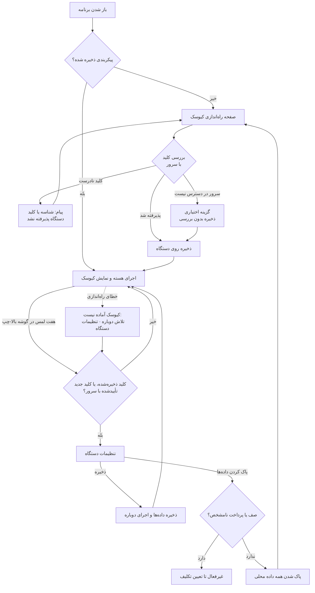

| فیلد | مقادیر | پیش‌فرض | توضیح |
| --- | --- | --- | --- |
| آدرس سرور | `http(s)://…` | وب‌اپ: آدرس همان سرور. اندروید: خالی | مثلاً `http://192.168.1.10:3000`. اسلش انتهایی حذف می‌شود |
| شناسه کیوسک | متن، حداکثر ۶۴ نویسه | `KIOSK-01` | همان شناسه پنل |
| کلید دستگاه | حداقل ۸ نویسه | — | در قالب رمز نمایش داده می‌شود |
| کارتخوان | شبیه‌ساز (آزمایشی) · متصل نشده | شبیه‌ساز | معادل `mock` و `none` نسخه ویندوز |
| چاپگر | چاپگر دستگاه · شبیه‌ساز | چاپگر دستگاه | وب‌اپ: چاپ مرورگر. اندروید: سرویس چاپ اندروید. شبیه‌ساز: بدون چاپ |
| اسکنر QR | اسکنر USB · شبیه‌ساز | اسکنر USB | اسکنر HID در حالت صفحه‌کلید |
| کنترل‌های آزمایشی | روشن · خاموش | خاموش | فقط برای آزمون |

مقادیر ثابت این دو نسخه: فواصل همگام‌سازی همان پیش‌فرض‌های جدول بالا، مهلت درخواست ۸ ثانیه و حالت کیوسک روشن.

محل نگهداری روی دستگاه:

| داده | محل |
| --- | --- |
| پیکربندی (شامل کلید دستگاه) | `localStorage` ← کلید `andishkadeh.kiosk.setup.v1` |
| پایگاه محلی و تصاویر | IndexedDB ← پایگاه `andishkadeh-kiosk` (بخش‌های `sqlite` و `media`) |

- **ورود دوباره به تنظیمات**: ۷ لمس پشت سر هم در کمتر از ۴ ثانیه، در مربع ۹۰ پیکسلی گوشه بالا-چپ صفحه، و سپس وارد کردن کلید دستگاه. بدون کلید دستگاه، تنظیمات باز نمی‌شود.
  - اگر در پنل «کلید جدید» ساخته شده باشد، کلید جدید هم پذیرفته می‌شود، به شرط آنکه سرور آن را برای همین شناسه کیوسک تأیید کند.
  - اگر برنامه نتواند راه‌اندازی شود (مثلاً حافظه مرورگر در دسترس نیست)، صفحه «کیوسک آماده نیست» دکمه «تنظیمات دستگاه» دارد.
- **ذخیره تنظیمات**: داده‌های در انتظار ذخیره می‌شوند و برنامه دوباره اجرا می‌شود.
- **شناسه کیوسک** تا وقتی رویداد ارسال‌نشده یا پرداخت نامشخص وجود دارد قابل تغییر نیست، چون آن رویدادها متعلق به همین شناسه‌اند. آدرس سرور و کلید را می‌توان تغییر داد.
- **پاک کردن داده‌های دستگاه**: پیکربندی، سفارش‌ها، کاتالوگ و تصاویر محلی پاک می‌شوند. تا وقتی رویداد ارسال‌نشده یا پرداخت نامشخص وجود دارد غیرفعال است.
- **پاک کردن داده مرورگر** یا **حذف برنامه اندروید** همین اثر را دارد. پیش از آن در پنل مطمئن شوید صف رویدادهای دستگاه صفر است.
- در اندروید پشتیبان‌گیری ابری برنامه خاموش است، پس کلید دستگاه به حساب Google منتقل نمی‌شود.
- برنامه اندروید از مبدأ `https://localhost` به سرور وصل می‌شود؛ آن را به `CORS_ORIGINS` سرور اضافه کنید.

### ۴. آداپترهای سخت‌افزار در هر نسخه

| تجهیز | مقدار | ویندوز | وب‌اپ | اندروید | رفتار |
| --- | --- | :---: | :---: | :---: | --- |
| کارتخوان | `mock` | ✓ | ✓ | ✓ | شبیه‌ساز با سناریوهای تأیید، رد، لغو و نامشخص. نوار «حالت آزمایشی» همیشه دیده می‌شود |
| کارتخوان | `none` | ✓ | ✓ | ✓ | SDK وصل نیست؛ فروش آغاز نمی‌شود |
| کارتخوان | `helper` | ✓ | | | برنامه کمکی SDK شرکت پرداخت (مثلاً آسان پرداخت) با پروتکل JSON. پاسخ مبهم یا توقف برنامه «نامشخص» است و استعلام می‌شود |
| چاپگر | `windows` | ✓ | | | چاپ بی‌صدا با درایور ویندوز، رسید ۸۰ میلی‌متر. اگر درایور در ۶۰ ثانیه پاسخ ندهد «چاپ نشد» |
| چاپگر | `browser` | | ✓ | ✓ | وب: قاب پنهان و ایزوله و چاپ مرورگر. اندروید: سرویس چاپ اندروید؛ «چاپ شد» فقط پس از تکمیل کار چاپ، و لغو پس از ۲ دقیقه |
| چاپگر | `mock` | ✓ | ✓ | ✓ | شبیه‌ساز. در ویندوز رسید به‌صورت فایل txt و html ذخیره می‌شود |
| اسکنر | `keyboard` | ✓ | ✓ | ✓ | ورودی سریع‌تر از تایپ انسان (فاصله کلیدها زیر ۳۰۰ میلی‌ثانیه) با Enter |
| اسکنر | `mock` | ✓ | ✓ | ✓ | اسکن فقط از کنترل‌های آزمون |

وضعیت هر تجهیز در کیوسک و پنل یکی از این‌هاست: «سالم»، «هشدار»، «خطا» یا «نامشخص». چاپگری که وضعیت کاغذ را گزارش نمی‌دهد (درایور ویندوز، مرورگر، اندروید) همیشه «نامشخص» نمایش داده می‌شود و هرگز «سالم» نوشته نمی‌شود. سمت کیوسک برای کارتخوان واقعی آماده است (`helper`). برنامه کمکی آسان پرداخت / بانک شهر پس از تحویل SDK آن شرکت نوشته می‌شود (ر.ک. [کارتخوان](docs/payment-helper.md) و [موارد باز](docs/open-items.md)).

### ۵. تنظیمات مرکز (پنل ← «تنظیمات»)

این مقادیر برای همه کیوسک‌ها یکسان است و با همگام‌سازی به آن‌ها می‌رسد. فقط مدیر اصلی تغییر می‌دهد و هر تغییر با مقدار قبل و بعد در سوابق تغییرات ثبت می‌شود.

| تنظیم | پیش‌فرض | بازه | اثر روی کیوسک |
| --- | --- | --- | --- |
| `centerName`، `centerSubtitle`، `logoMediaId` | اندیشکده کشتی ایران | — | سربرگ کیوسک و رسید |
| `receiptHeader`، `receiptFooter` | رسید فروش خدمات · متن عدم تعیین نوبت | حداکثر ۵۰۰ نویسه | متن بالا و پایین رسید |
| `supportText` | «در صورت نیاز به راهنمایی به پذیرش مراجعه کنید.» | حداکثر ۳۰۰ | متن راهنما در کیوسک |
| `sessionTimeoutSec` | ۹۰ | ۳۰ تا ۹۰۰ ثانیه | بی‌فعالیتی تا پاک شدن نشست |
| `timeoutWarningSec` | ۱۵ | ۵ تا ۶۰ | شمارش معکوس پیش از پاک شدن نشست |
| `endScreenSec` | ۸ | ۳ تا ۶۰ | ماندن صفحه پایان پیش از بازگشت به شروع |
| `paymentTimeoutSec` | ۱۲۰ | ۳۰ تا ۳۰۰ | انتظار برای کارتخوان؛ پس از آن نتیجه «نامشخص» و استعلام |
| `maxItemQuantity` | ۵ | ۱ تا ۲۰ | حداکثر تعداد هر خدمت در سبد |
| `discountPolicy` | `BEST` | `BEST` · `PRIORITY` | انتخاب بهترین تخفیف، یا تخفیف با بالاترین اولویت |
| `renewalPolicy` | `EXTEND_FROM_END` | `EXTEND_FROM_END` · `START_NOW` | شروع تمدید از پایان اشتراک فعلی یا از لحظه پرداخت |
| `offlineQrValidation` | روشن | — | بررسی QR از کش هنگام قطع شبکه |
| `offlineSalesEnabled` | روشن | — | فروش خدمات آفلاین با کد `OFF-…` |
| `offlineSubscriptionSales` | خاموش | — | فروش اشتراک آفلاین (سیاست سند هنوز باز است) |
| `offlineCatalogMaxAgeHours` | ۷۲ | ۱ تا ۷۲۰ ساعت | پس از این مدت بدون تأیید سرور، فروش آفلاین متوقف می‌شود |
| `timezone` | `Asia/Tehran` | — | منطقه زمانی تاریخ‌های کیوسک و رسید |

### ۶. کیوسک در پنل مدیریت

صفحه «کیوسک‌ها و تجهیزات» برای هر دستگاه نشان می‌دهد:

- آخرین ارتباط و وضعیت آنلاین (پنجره ۲ دقیقه)
- نسخه برنامه و نسخه کاتالوگ
- وضعیت کارتخوان، چاپگر و اسکنر
- رویدادهای در صف، رویدادهای ردشده و قدیمی‌ترین رویداد ارسال‌نشده
- پرداخت‌های نامشخص و آخرین همگام‌سازی

اقدام‌ها (فقط مدیر اصلی؛ اپراتور فقط مشاهده می‌کند، به‌جز استعلام و چاپ مجدد):

| اقدام | اثر |
| --- | --- |
| ثبت کیوسک جدید | ساخت شناسه و کلید (کلید یک بار نمایش داده می‌شود) |
| کلید جدید | کلید قبلی فوراً باطل می‌شود؛ کیوسک تا وارد کردن کلید جدید قطع است |
| غیرفعال‌سازی / فعال‌سازی | دستگاه غیرفعال هیچ درخواستی را نمی‌تواند انجام دهد |
| همگام‌سازی کیوسک | فرمان `SYNC_NOW`: رویدادهای ردشده دستگاه به صف برمی‌گردند، صف ارسال و کاتالوگ دریافت می‌شود (تکرار امن است؛ سرور رویداد تکراری را دوباره اعمال نمی‌کند) |
| استعلام پرداخت | فرمان `PAYMENT_INQUIRY` برای یک تلاش نامشخص |
| چاپ مجدد رسید | فرمان `PRINT_RECEIPT`؛ رسید بدون QR و با برچسب «چاپ مجدد» |

فرمان‌ها با heartbeat بعدی به کیوسک می‌رسند. هر فرمان شناسه یکتا دارد و اجرای دوباره‌اش بی‌اثر است.

### ۷. فهرست بررسی پیش از بهره‌برداری

- [ ] `serverUrl` با HTTPS و `PUBLIC_BASE_URL` سرور از روی کیوسک در دسترس است.
- [ ] کیوسک در پنل ثبت شده و کلید روی دستگاه وارد شده؛ دستگاه «آنلاین» است.
- [ ] `devControls` / «کنترل‌های آزمایشی» خاموش است.
- [ ] نوار «حالت آزمایشی» دیده نمی‌شود، یعنی هیچ آداپتری شبیه‌سازی‌شده نیست. تا رسیدن SDK کارتخوان این شرط برقرار نمی‌شود.
- [ ] چاپ آزمایشی رسید و اسکن یک QR معتبر روی همان دستگاه انجام شده است.
- [ ] تنظیمات مرکز (مهلت‌ها و سیاست‌های آفلاین) تأیید شده‌اند.
- [ ] ویندوز: `kioskMode` روشن و حساب کیوسک با Assigned Access یا Shell Launcher قفل شده. اندروید: Lock Task یا App pinning فعال است. وب‌اپ: Chrome با `--kiosk`.

### ۸. عیب‌یابی سریع

| نشانه | علت محتمل | اقدام |
| --- | --- | --- |
| نوار «ارتباط با مرکز برقرار نیست» | شبکه یا `serverUrl` | شبکه و آدرس را بررسی کنید. فروش خدمات با کاتالوگ ذخیره‌شده تا `offlineCatalogMaxAgeHours` ادامه دارد |
| دستگاه در پنل «قطع ارتباط» ولی شبکه سالم | کلید نادرست، کلید جدید ساخته شده یا دستگاه غیرفعال (خطای 401) | کلید را دوباره وارد کنید یا دستگاه را فعال کنید |
| نوار «حالت آزمایشی» | دست‌کم یک آداپتر `mock` است | آداپترها را بررسی کنید |
| وب‌اپ: «کیوسک در زبانه یا پنجره دیگری باز است» | دو زبانه هم‌زمان | زبانه دیگر را ببندید و «تلاش دوباره» را بزنید |
| وب‌اپ بدون سرور بالا نمی‌آید | Service Worker فقط روی HTTPS فعال است | سرور را با HTTPS ارائه کنید |
| اندروید: «سرور در دسترس نیست» با آدرس درست | CORS سرور | `https://localhost` را به `CORS_ORIGINS` اضافه کنید |
| پرداخت «نامشخص» | پاسخ کارتخوان نرسیده | کیوسک خودکار استعلام می‌کند؛ از پنل هم «استعلام» یا «تطبیق دستی» ممکن است |

## نمودارهای فعالیت UML

نه فرایند اصلی با نمودار فعالیت استاندارد UML رسم شده‌اند: ستون برای هر بازیگر، گره آغاز و پایان، لوزی تصمیم، و میله انشعاب و پیوند برای کارهای هم‌زمان. توضیح هر نمودار در [نمودارهای فعالیت UML](docs/uml-activity-diagrams.md) است. منبع PlantUML همه در [`docs/uml`](docs/uml) است و با `pnpm docs:uml` دوباره ساخته می‌شوند.

| # | فرایند | بازیگران |
| --- | --- | --- |
| ۱ | [خرید خدمات](docs/uml/01-service-purchase.png) | مشتری، کیوسک، سرور |
| ۲ | [خرید اشتراک و صدور کارت QR](docs/uml/02-subscription-purchase.png) | مشتری، کیوسک، سرور |
| ۳ | [پرداخت با کارتخوان، ژورنال و بازیابی](docs/uml/03-card-payment.png) | هسته کیوسک، پایگاه محلی، سرور، کارتخوان |
| ۴ | [ورود اعضا و بررسی کارت QR](docs/uml/04-member-qr-check.png) | عضو، کیوسک، سرور |
| ۵ | [همگام‌سازی پس‌زمینه کیوسک](docs/uml/05-background-sync.png) | کیوسک (چهار حلقه هم‌زمان) |
| ۶ | [راه‌اندازی و ثبت دستگاه](docs/uml/06-device-provisioning.png) | مدیر اصلی، سرور، تکنسین، کیوسک |
| ۷ | [تغییر در پنل تا رسیدن به کیوسک](docs/uml/07-admin-change-to-kiosk.png) | مدیر اصلی، سرور، کیوسک |
| ۸ | [پیگیری پرداخت نامشخص در پنل](docs/uml/08-unknown-payment-followup.png) | اپراتور یا مدیر، سرور، کیوسک |
| ۹ | [مهلت بی‌فعالیتی و پایان نشست](docs/uml/09-session-timeout.png) | کیوسک، مشتری |

نمونه: خرید خدمات

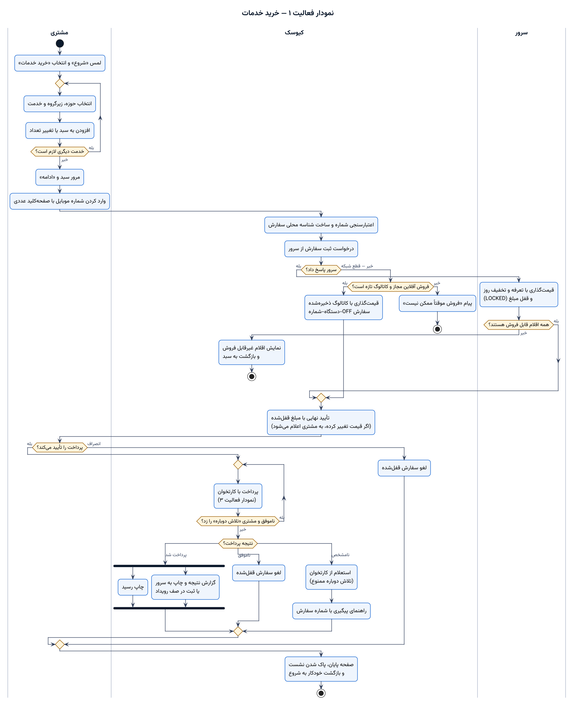

## راه‌اندازی محیط توسعه

پیش‌نیازها:

- Node.js 22 و pnpm 10 (`corepack enable`)
- PostgreSQL 14 یا بالاتر
- نصب‌کننده ویندوز: ویندوز ۱۰/۱۱ x64، یا لینوکس با wine، یا CI
- APK اندروید: JDK 21 و Android SDK، یا CI

```bash
pnpm install
cp apps/server/.env.example apps/server/.env   # مقادیر CHANGE_ME را پر کنید
pnpm db:migrate                                # اعمال migrationها (غیرمخرب)
pnpm db:seed                                   # داده اولیه: حوزه‌ها، خدمات، پلن‌ها، کاربران، دستگاه KIOSK-01
pnpm --filter @andishkadeh/shared build
```

سپس هر کدام را در یک ترمینال جدا اجرا کنید:

| دستور | آدرس |
| --- | --- |
| `pnpm dev:server` | API: `http://localhost:3000/api/v1`، مستند API: `http://localhost:3000/api/docs` |
| `pnpm dev:admin` | پنل مدیریت: `http://localhost:5173/admin/` |
| `pnpm dev:kiosk` | کیوسک در مرورگر: `http://localhost:5174`، هسته کیوسک (bridge) روی پورت 5175 |
| `pnpm --filter @andishkadeh/kiosk dev:app` | نسخه وب‌اپ/اندروید (هسته داخل صفحه، صفحه راه‌اندازی): `http://localhost:5176` |

- `pnpm dev:kiosk` همان هسته کیوسک (SQLite، صف همگام‌سازی، ژورنال پرداخت) را در Node اجرا می‌کند و تجهیزات را شبیه‌سازی می‌کند. نوار «حالت آزمایشی» همیشه دیده می‌شود و شبیه‌سازها هرگز اتصال واقعی معرفی نمی‌شوند.
- ورود به پنل: `SEED_ADMIN_*` و `SEED_OPERATOR_*` در `apps/server/.env`.
- کلید دستگاه توسعه `SEED_DEVICE_KEY` است و باید با `KIOSK_DEVICE_KEY` یکی باشد. پیش‌فرض bridge توسعه `dev-kiosk-key-0123456789` است.

## دستورها

| دستور | کار |
| --- | --- |
| `pnpm build` | ساخت همه بسته‌ها |
| `pnpm typecheck` | بررسی نوع‌ها در همه بسته‌ها |
| `pnpm lint` | ESLint با تنظیم `eslint.config.mjs`: قواعد پیشنهادی JavaScript و TypeScript، قواعد hookهای React و قواعد نوع‌آگاه Promise؛ در CI هم اجرا می‌شود |
| `pnpm version:check` / `pnpm version:set X.Y.Z` | بررسی یا تغییر نسخه واحد محصول در همه `package.json`ها (ر.ک. [انتشار نسخه](docs/release.md)) |
| `pnpm knip` | یافتن کد مرده (فایل، export و وابستگی بی‌استفاده) با تنظیم `knip.jsonc`؛ در CI هم اجرا می‌شود |
| `pnpm test` | تست‌های واحد و یکپارچه (shared، server روی پایگاه `*_test`، هسته کیوسک روی هر دو درایور SQLite) |
| `pnpm e2e` | تست‌های پذیرش Playwright روی پشته جداگانه (پورت‌های 3200/5283/5284/5285 و وب‌اپ روی `3200/kiosk/`) |
| `pnpm --filter @andishkadeh/server openapi` | تولید `docs/openapi.json` |
| `pnpm --filter @andishkadeh/kiosk dist:win` | ساخت نصب‌کننده ویندوز کیوسک (NSIS) |
| `pnpm --filter @andishkadeh/kiosk build:web` | ساخت وب‌اپ کیوسک (`apps/kiosk/dist-web`، برای `KIOSK_WEB_DIST_DIR` سرور) |
| `pnpm --filter @andishkadeh/kiosk android:apk` | ساخت APK اندروید (debug) |
| `python3 tools/icons/generate.py --android apps/kiosk/android/app/src/main/res` | تولید دوباره آیکون‌ها و صفحه آغاز |
| `pnpm docs:uml` | ساخت دوباره نمودارهای فعالیت UML (PNG و SVG) از منبع PlantUML |

## ساخت خروجی‌ها و CI

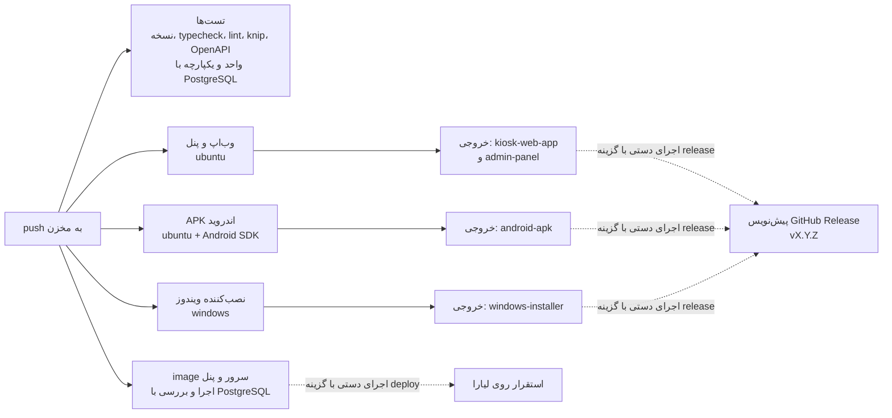

- گردش‌کار در [`.github/workflows/apps.yml`](.github/workflows/apps.yml) است. خروجی‌ها از صفحه هر اجرا در GitHub Actions (بخش Artifacts) دانلود می‌شوند.
- image سرور و پنل (`Dockerfile`) در هر push ساخته، با پایگاه داده خالی اجرا و بررسی می‌شود. اجرای دستی با گزینه «Deploy … to Liara» همان commit را روی لیارا مستقر می‌کند ([استقرار روی لیارا](docs/liara-deploy.md)).
- برای انتشار، «Apps» را دستی با گزینه «Create a draft GitHub Release» اجرا کنید. همه خروجی‌ها در یک پیش‌نویس انتشار جمع می‌شوند که با «Publish» منتشر می‌شود. ر.ک. [انتشار نسخه](docs/release.md).
- APK آزمایشی با کلید debug همان اجرا امضا می‌شود. برای نسخه انتشار با امضای ثابت، secretهای `ANDROID_KEYSTORE_BASE64`، `ANDROID_KEYSTORE_PASSWORD`، `ANDROID_KEY_ALIAS` و `ANDROID_KEY_PASSWORD` را تعریف کنید (ر.ک. [سه نسخه کیوسک](docs/kiosk-platforms.md#اندروید)).
- پس از `dist:win` روی سیستم توسعه، ماژول بومی SQLite برای Electron ساخته شده است. برای اجرای دوباره تست‌ها: `cd apps/kiosk/node_modules/better-sqlite3 && npx prebuild-install --force`.

## تست‌ها

| لایه | ابزار | تعداد |
| --- | --- | --- |
| واحد (قیمت، تخفیف، تقویم جلالی، موبایل، QR، دوره اشتراک، هش و توکن) | Vitest (`packages/shared`) | ۳۷ |
| یکپارچه سرور (HTTP واقعی + PostgreSQL آزمون) | Vitest (`apps/server`) | ۴۳ |
| یکپارچه هسته کیوسک روی `better-sqlite3` و `sql.js` + درایور `sql.js` + کلاینت API + برنامه کمکی کارتخوان + صفحه راه‌اندازی ویندوز | Vitest (`apps/kiosk`) | ۴۰ |
| پذیرش E2E (ماتریس T01 تا T15، پنل، وب‌اپ، پنل تولیدی زیر CSP و صفحه راه‌اندازی ویندوز) | Playwright (`e2e`) | ۳۴ |

جزئیات و ماتریس پذیرش: [گزارش تست](docs/test-report.md). آخرین QA مرورگری و API با روش gstack: [گزارش QA](docs/qa/gstack-qa-2026-10-16.md).

## ساختار مخزن

| مسیر | توضیح |
| --- | --- |
| `packages/shared` | قراردادهای مشترک (zod)، موتور قیمت‌گذاری و تخفیف، تقویم جلالی، قالب‌بندی پول و موبایل، QR، هش و توکن |
| `apps/server` | سرور NestJS + Prisma + PostgreSQL: API کیوسک و پنل، احراز هویت، RBAC، همگام‌سازی، گزارش‌ها، OpenAPI |
| `apps/kiosk/src/core` | هسته کیوسک مستقل از سکو: سفارش، پرداخت، صف رویداد، کاتالوگ، QR، آداپترها |
| `apps/kiosk/src/renderer` | رابط کیوسک (React)، صفحه راه‌اندازی (وب‌اپ، اندروید و اجرای اول ویندوز) |
| `apps/kiosk/src/platform` | میزبان‌های هسته: `node` (ویندوز، bridge، تست) و `web` (وب‌اپ و اندروید)، درایور `sqljs.ts` |
| `apps/kiosk/electron` | پوسته Electron: فرایند اصلی، preload، چاپگر ویندوز |
| `apps/kiosk/android` | پروژه اندروید (Capacitor): پوسته تمام‌صفحه و افزونه چاپ |
| `apps/admin` | پنل مدیریت React (SPA) |
| `e2e` | تست‌های پذیرش Playwright |
| `assets/seed-media` | تصاویر اولیه حوزه‌ها، خدمات و صفحه شروع |
| `tools/icons` | تولید آیکون‌ها و صفحه آغاز همه نسخه‌ها از یک طرح |
| `tools/uml`، `docs/uml` | اسکریپت ساخت و منبع نمودارهای فعالیت UML (PlantUML) |
| `.github/workflows` | ساخت خودکار: تست‌ها، وب‌اپ، APK اندروید، نصب‌کننده ویندوز، پیش‌نویس انتشار |
| `tools/release` | نسخه واحد محصول و یادداشت انتشار از CHANGELOG |
| `docs` | مستندات فنی، راهنماهای نصب، OpenAPI |

## مستندات

- [همه مستندات در یک صفحه HTML](docs/andishkadeh-docs.html) — در مرورگر باز کنید؛ قلم‌ها و نمودارها با اتصال اینترنت بارگذاری می‌شوند
- [معماری، مدل داده و نمودارهای وضعیت](docs/architecture.md)
- [نمودارهای فعالیت UML](docs/uml-activity-diagrams.md)
- **[راه‌اندازی برای بهره‌برداری (لیارا، کیوسک ویندوز، کارتخوان)](docs/go-live.md)**
- [استقرار سرور و پنل روی لیارا](docs/liara-deploy.md)
- [راه‌اندازی سرور و پنل مدیریت (نصب مستقیم)](docs/server-setup.md)
- [نصب و پیکربندی کیوسک ویندوز](docs/windows-kiosk-install.md)
- [سه نسخه کیوسک: ویندوز، وب‌اپ و اندروید](docs/kiosk-platforms.md)
- [کارتخوان بانکی و برنامه کمکی PC-POS](docs/payment-helper.md)
- [پشتیبان‌گیری و بازیابی](docs/backup-restore.md)
- [انتشار نسخه و به‌روزرسانی محیط عملیاتی](docs/release.md)
- [گزارش تست و ماتریس پذیرش](docs/test-report.md)
- [موارد باز و فرض‌ها](docs/open-items.md)
- [مرجع API (OpenAPI 3)](docs/openapi.json)
- [تغییرات نسخه](CHANGELOG.md)
