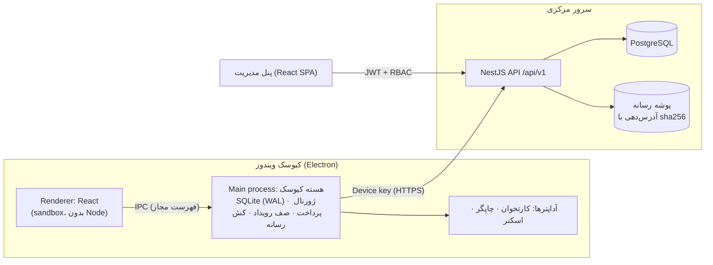
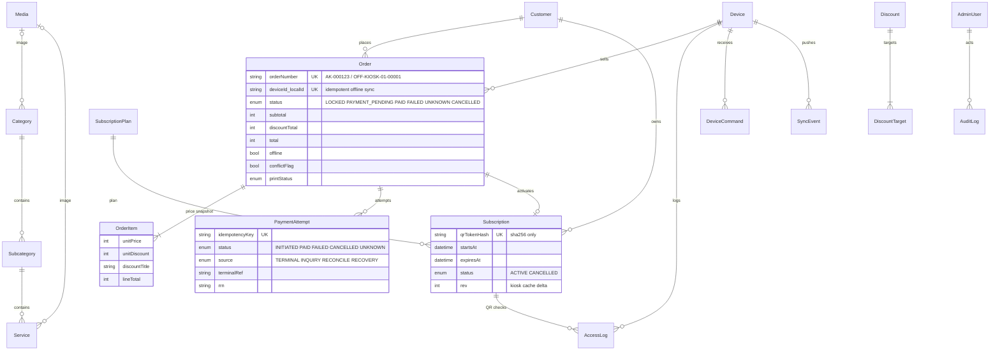
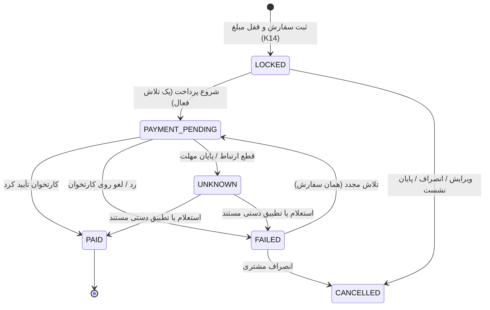
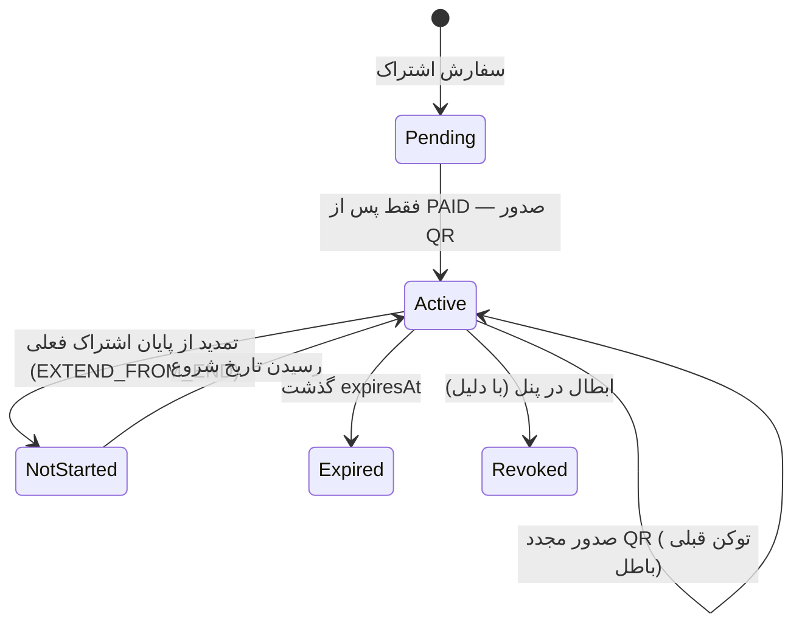
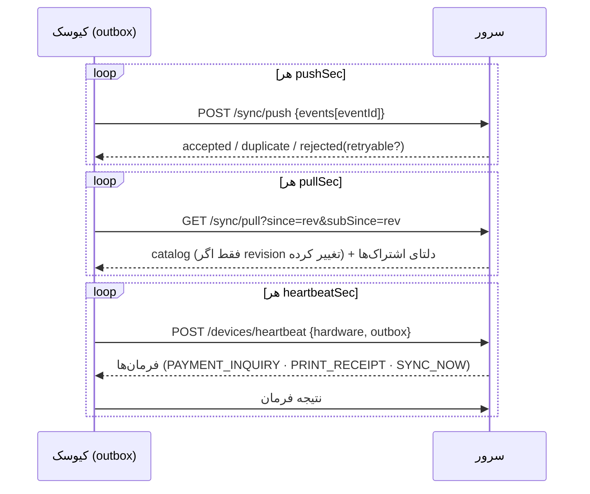

# معماری سامانه

## نمای کلی

- **قراردادها در یک جا**: همه درخواست‌ها و پاسخ‌ها در `packages/shared/src/contracts` با zod تعریف شده‌اند. سرور ورودی را با همین schemaها اعتبارسنجی می‌کند، کلاینت‌ها نوع‌ها را از همان‌جا می‌گیرند و OpenAPI هم از همین تعریف‌ها تولید می‌شود.
- **پول**: همه مبالغ عدد صحیح تومان هستند. قیمت و تخفیف هر قلم در لحظه قفل سفارش در `OrderItem` به‌صورت snapshot ذخیره می‌شود. تغییر بعدی تعرفه یا تخفیف، سفارش‌های قبلی را تغییر نمی‌دهد.
- **موتور قیمت**: `packages/shared/src/pricing.ts` هم در سرور و هم در کیوسک اجرا می‌شود:
  - تخفیف به ازای هر واحد اعمال می‌شود و هدف آن می‌تواند خدمت، زیرگروه، حوزه یا پلن باشد.
  - سیاست انتخاب تخفیف `BEST` (پیش‌فرض) یا `PRIORITY` است و تساوی‌ها به‌صورت قطعی شکسته می‌شوند.
  - مرجع نهایی همیشه سرور است: اگر مبلغ پیش‌نمایش با مبلغ سرور فرق کند، مشتری پیش از پرداخت مطلع می‌شود.
- **تقویم**: نمایش تاریخ‌ها جلالی است و مرز روز با منطقه زمانی `Asia/Tehran` محاسبه می‌شود (`dates.ts`).

## سرور (`apps/server`)

| ماژول | مسئولیت |
| --- | --- |
| `auth` | ورود مدیر (JWT HS256 با `tokenVersion`)، قفل موقت پس از ۵ تلاش ناموفق به مدت ۱۵ دقیقه، محدودیت نرخ ورود برای هر IP، تغییر رمز و کاربران |
| `catalog` | حوزه، زیرگروه، خدمت، پلن، تخفیف، رسانه، محتوا و تنظیمات. هر تغییر `catalogRevision` را افزایش می‌دهد |
| `sales` | سفارش، پرداخت، فعال‌سازی اشتراک، بررسی اعتبار QR، دستگاه‌ها و فرمان‌ها، همگام‌سازی push/pull |
| `admin` | داشبورد، گزارش‌ها و خروجی CSV/XLSX، عملیات پشتیبانی (تطبیق، چاپ مجدد، ابطال، تمدید، صدور مجدد QR)، سوابق تغییرات |

- **احراز هویت دستگاه**: هدر `Authorization: Device <id>:<key>`. سرور فقط sha256 کلید را نگه می‌دارد و کلید از پنل قابل تعویض است.
- **RBAC در سرور**: دسترسی با `@Roles(ADMIN)` کنترل می‌شود. اپراتور فقط مشاهده، استعلام پرداخت و چاپ مجدد دارد. پنهان کردن دکمه در رابط، تنها لایه حفاظت نیست (تست T10).
- **خطاها**: قالب یکسان `{ error: { code, message, details }, requestId }` با هدر `X-Request-Id` در همه پاسخ‌ها.
- **سوابق تغییرات**: تغییر قیمت، تخفیف، تنظیمات، تطبیق پرداخت، ابطال و تمدید اشتراک، صدور مجدد QR و کاربران با مقادیر قبل و بعد و دلیل در `AuditLog` ثبت می‌شود و قابل ویرایش نیست.
- **تراکنش‌ها**: عملیات مالی در تراکنش `Serializable` با تکرار خودکار هنگام تداخل انجام می‌شوند.

## کیوسک (`apps/kiosk`)

- **فرایند اصلی (main)**: `src/core` شامل موارد زیر است:
  - کاتالوگ و کش رسانه با بررسی sha256 و جایگزین برای هر موجودیت
  - سفارش و پرداخت با ژورنال پیش از استفاده از کارتخوان
  - صف رویداد (outbox) و همگام‌سازی
  - بررسی اعتبار QR آنلاین و آفلاین
  - اجرای فرمان‌های پنل

  پایگاه محلی SQLite با `journal_mode=WAL` و `synchronous=FULL` کار می‌کند.
- **رابط (renderer)**: React با `contextIsolation` و `sandbox`، بدون دسترسی به Node. ارتباط فقط از طریق کانال‌های مجاز IPC (`src/core/types.ts`) برقرار می‌شود. کلید دستگاه هرگز به رابط نمی‌رسد.
- **آداپترهای سخت‌افزار** (`src/core/hardware`):

  | تجهیز | آداپتر |
  | --- | --- |
  | کارتخوان | `mock` (شبیه‌ساز با سناریو) یا `none` (SDK پیکربندی نشده؛ فروش متوقف می‌شود). SDK واقعی بانک هنوز در دست نیست؛ ر.ک. [موارد باز](open-items.md) |
  | چاپگر | `mock` (ذخیره رسید در پوشه) یا `windows` (چاپ بی‌صدا با درایور ویندوز) |
  | اسکنر | `keyboard` (USB HID در حالت keyboard-wedge) یا `mock` |

  هر آداپتر شبیه‌سازی‌شده نوار «حالت آزمایشی» را روی صفحه نشان می‌دهد.
- **بازیابی**:
  - پس از قطع برق یا بسته شدن برنامه، ژورنال پرداخت بررسی می‌شود. تلاش‌های `IN_FLIGHT` یا `UNKNOWN` از کارتخوان استعلام می‌شوند و نتیجه گزارش می‌شود.
  - اگر renderer از کار بیفتد، دوباره بارگذاری می‌شود.
  - برنامه تک‌نمونه است و از خواب رفتن سیستم جلوگیری می‌کند.

## مدل داده (ERD خلاصه)

جدول‌های تکمیلی:

| جدول | کاربرد |
| --- | --- |
| `Setting` | سیاست‌ها و تنظیمات قابل تغییر در پنل |
| `Counter` | شماره سفارش، `catalogRevision` و `subscriptionRev` |
| `SyncEvent` | ثبت یکتای رویدادهای دستگاه با `eventId` |

## نمودارهای وضعیت

### سفارش و پرداخت

- تا وقتی وضعیت `UNKNOWN` است، تلاش جدید ممنوع است و این وضعیت هرگز موفق یا ناموفق نمایش داده نمی‌شود. فروش قطعی هم فقط شامل `PAID` است.
- `PAID` هرگز بازنویسی نمی‌شود. گزارش متناقض بعدی فقط `conflictFlag` را فعال می‌کند تا در پنل بررسی شود.
- چاپ نشدن رسید سفارش را لغو نمی‌کند. وضعیت چاپ (`printStatus`) جدا نگه داشته می‌شود و چاپ مجدد از کیوسک یا پنل ممکن است.

### اشتراک و QR

- توکن QR (`AKQ1.` و ۳۲ نویسه تصادفی) روی کیوسک ساخته می‌شود. سرور فقط sha256 آن را نگه می‌دارد. در QR نه شماره موبایل هست و نه اطلاعات کارت.
- نتیجه بررسی یکی از `ACTIVE`، `EXPIRED`، `NOT_STARTED`، `REVOKED` یا `INVALID` است. نمایش عضو فقط به ۴ رقم آخر موبایل محدود است.
- بررسی آفلاین از کش محلی کیوسک انجام می‌شود (سیاست `offlineQrValidation`). کش با دلتای `rev` به‌روز می‌شود.

### همگام‌سازی کیوسک

- **انواع رویداد**: `ORDER_OFFLINE`، `PAYMENT_RESULT`، `ACCESS_LOG`، `RECEIPT_PRINT` و `COMMAND_RESULT`.
- **یکتایی**: هر رویداد با `eventId` یکتا ثبت می‌شود و سفارش آفلاین با `(deviceId, localId)`. ارسال دوباره هرگز سفارش تکراری نمی‌سازد (تست T11).
- **خطاهای قابل تکرار** (مثلاً سفارشی که هنوز همگام نشده) با تأخیر دوباره ارسال می‌شوند. خطاهای غیرقابل تکرار در پنل «همگام‌سازی» برای بررسی و اعمال مجدد نمایش داده می‌شوند.

## امنیت (خلاصه)

- **کیوسک**:
  - IPC محدود به فهرست مجاز، و مسدود بودن ناوبری و پنجره جدید
  - CSP در بیلد تولید
  - کلید دستگاه فقط در main process
  - پاک شدن QR خام و ماسک شدن موبایل در پایان نشست
- **سرور**:
  - هش رمز با bcrypt و قفل موقت حساب
  - اعتبارسنجی همه ورودی‌ها با zod
  - هدرهای امنیتی و CORS محدود
  - رسانه با آدرس محتوایی (sha256) و نوع فایل بررسی‌شده
- **پنل**: توکن در `sessionStorage` که با بستن مرورگر حذف می‌شود. تغییر رمز همه نشست‌های قبلی را باطل می‌کند.
