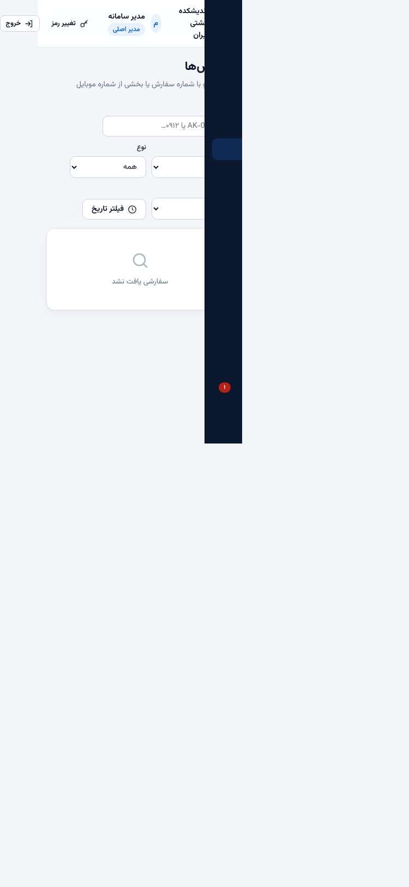
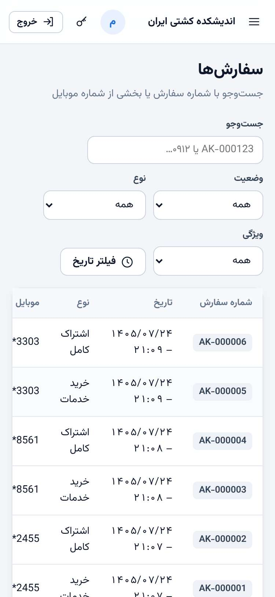
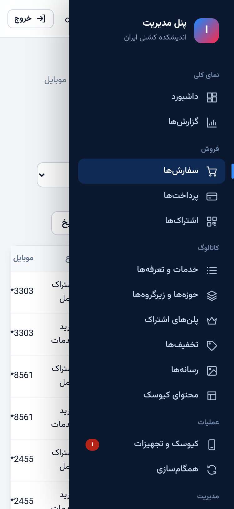
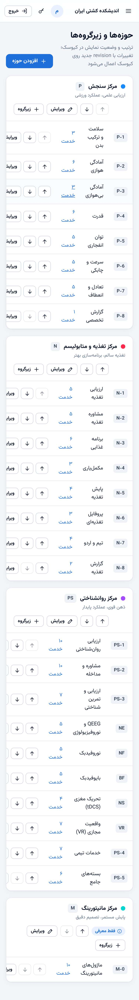

# گزارش QA با روش gstack `/qa` — ۲۴ مهر ۱۴۰۵

این گزارش با گردش‌کار مهارت [`/qa` از gstack](https://github.com/garrytan/gstack) تهیه شده است:
- تعیین محدوده و جداسازی
- آزمون پایه و امتیاز سلامت
- دسته‌بندی ایرادها
- رفع هر ایراد با یک تست رگرسیون که پیش از رفع شکست می‌خورد، و یک commit جدا برای هر ایراد
- آزمون نهایی و گزارش

| مورد | مقدار |
| --- | --- |
| **تاریخ** | 2026-10-16 (۲۴ مهر ۱۴۰۵) |
| **هدف** | build تولیدی روی `http://localhost:3400`: پنل `/admin/`، وب‌اپ کیوسک `/kiosk/`، API `/api/v1` |
| **جداسازی** | پایگاه جداگانه `andishkadeh_qa` و پوشه رسانه جداگانه؛ فقط هویت‌های آزمایشی |
| **شاخه** | `claude/cool-goldberg-0916n3` |
| **سطح** | Standard (رفع بحرانی، بالا و متوسط) به‌همراه دو مورد کم‌اهمیت ساده |
| **حالت** | Full: همه صفحه‌های قابل دسترس |
| **مرورگر** | Chromium بدون رابط با Playwright خود پروژه |
| **صفحه‌ها** | ۱۶ صفحه پنل در ۴ عرض (۳۷۵، ۶۰۰، ۷۶۸، ۱۰۲۴ و ۱۴۴۰)، همه صفحه‌های کیوسک و ۳۱ کاوش API |
| **تصاویر شاهد** | ۶۶ (نسخه کامل در `.gstack/qa-reports/` روی دستگاه آزمون، خارج از git) |
| **فریم‌ورک** | SPA (React + Vite) و NestJS |

> **درباره ابزار.** نصب سراسری gstack (`./setup`) در این محیط hookهایی روی ابزارهای خود Claude ثبت می‌کرد. ساختن ابزار مرورگر آن (`bun install` و کامپایل) هم توسط بررسی ایمنی محیط مسدود شد. به همین دلیل گردش‌کار، قواعد، شیوه امتیازدهی و قالب گزارش gstack دقیقاً دنبال شد، ولی مرورگر با Playwright خود پروژه کنترل شد. ابزار gstack هم در زیر از همین موتور استفاده می‌کند.

## امتیاز سلامت: ۹۲ → ۱۰۰

| دسته (وزن) | پایه | نهایی |
| --- | ---: | ---: |
| کنسول (۱۵٪) | ۱۰۰ | ۱۰۰ |
| لینک‌ها (۱۰٪) | ۱۰۰ | ۱۰۰ |
| ظاهر (۱۰٪) | ۱۰۰ | ۱۰۰ |
| عملکرد (۲۰٪) | ۶۵ | ۱۰۰ |
| تجربه کاربری (۱۵٪) | ۹۷ | ۹۷ |
| کارایی (۱۰٪) | ۱۰۰ | ۱۰۰ |
| محتوا (۵٪) | ۱۰۰ | ۱۰۰ |
| دسترس‌پذیری (۱۵٪) | ۹۷ | ۱۰۰ |
| **جمع وزنی** | **۹۲** | **۱۰۰** (۹۹٫۶) |

امتیاز پایه در اولین اندازه‌گیری ۹۴ بود. ISSUE-007 پشت ISSUE-002 پنهان بود و در آزمون نهایی پیدا شد. چون از ابتدا وجود داشت، برای مقایسه با پوشش یکسان در امتیاز پایه هم حساب شده است.

## سه مورد مهم

1. **ISSUE-001:** خطاهای فایل‌های ایستا و تجزیه بدنه درخواست به‌صورت «خطای داخلی سرور» (500) گزارش می‌شد.
2. **ISSUE-002 و ISSUE-007:** پنل مدیریت روی گوشی قابل استفاده نبود؛ منو باز نمی‌شد و صفحه از عرض گوشی بیرون می‌زد.
3. **ISSUE-004:** پنل مدیریت هیچ Content-Security-Policy نداشت.

## خلاصه

| شدت | تعداد | رفع‌شده |
| --- | ---: | ---: |
| بحرانی | ۰ | — |
| بالا | ۰ | — |
| متوسط | ۴ | ۴ |
| کم | ۳ | ۲ (یکی به تعویق افتاد) |
| **جمع** | **۷** | **۶** |

## ایرادها

### ISSUE-001: خطاهای middleware به‌صورت ۵۰۰ گزارش می‌شد

| شدت | دسته | آدرس |
| --- | --- | --- |
| متوسط | عملکرد | `/api/v1/media/files/*`، `/kiosk/*`، همه درخواست‌های JSON |

- **رفتار پیش از رفع:**
  - فایل رسانه یا فایل وب‌اپ ناموجود: 500 «خطای داخلی سرور» و ثبت ERROR در لاگ سرور
  - درخواست فایل نقطه‌دار مانند `.env`: همین 500
  - بدنه بزرگ‌تر از ۲ مگابایت: 500
  - JSON خراب: کد `INTERNAL` با متن انگلیسی خطای تجزیه
- **انتظار:** 404، 403 و 413 با کد و پیام فارسی.
- **علت:** خطاهای `express.static` و body parser از نوع http-errors هستند، نه `HttpException`. فیلتر سراسری آن‌ها را نمی‌شناخت.
- **رفع:** وضعیت 4xx آن‌ها حفظ می‌شود و کد مناسب با پیام فارسی برمی‌گردد. خطاهای داخلی فریم‌ورک دیگر متن انگلیسی خود را برنمی‌گردانند.

### ISSUE-002: پنل مدیریت روی گوشی؛ منو باز نمی‌شد

| شدت | دسته | آدرس |
| --- | --- | --- |
| متوسط | عملکرد | همه صفحه‌های پنل در عرض ۳۷۵ |

- **رفتار:**
  - نوار بالا به ۴۴۴ پیکسل جا نیاز داشت: نام، نقش، «تغییر رمز» و «خروج».
  - صفحه از گوشی پهن‌تر می‌شد و گوشه منوی مخفی دیده می‌شد.
  - عنوان روی دکمه منو می‌افتاد، پس منو اصلاً باز نمی‌شد.
- **رفع:**
  - در عرض کمتر از ۷۲۰ پیکسل، عنوان کوتاه می‌شود و نام، نقش و متن دکمه جای خود را به آیکون می‌دهند.
  - منوی بسته کاملاً پنهان است و پیوندهایش با Tab هم در دسترس نیستند.

| پیش از رفع | پس از رفع | منوی باز |
| --- | --- | --- |
|  |  |  |

### ISSUE-003: فیلتر تاریخ تاریخ ناممکن را می‌پذیرفت

| شدت | دسته | آدرس |
| --- | --- | --- |
| کم | عملکرد | گزارش‌ها، سفارش‌ها، پرداخت‌ها، داشبورد |

- **رفتار:**
  - `2026-02-30` بی‌صدا به ۲ مارس تبدیل می‌شد.
  - `2026-13-40` پیام گمراه‌کننده «تاریخ شروع بعد از پایان است» می‌داد.
  - خطای بازه با 409 برمی‌گشت.
- **رفع:**
  - فقط روز واقعی تقویم پذیرفته می‌شود.
  - خطای بازه با 400 برمی‌گردد.

### ISSUE-004: پنل مدیریت بدون Content-Security-Policy

| شدت | دسته | آدرس |
| --- | --- | --- |
| متوسط | عملکرد (امنیت) | `/admin/` |

- **رفتار:** پنل توکن نشست را در sessionStorage نگه می‌دارد، ولی هیچ CSP نداشت. کیوسک وب CSP داشت.
- **رفع:**
  - CSP سخت‌گیرانه در build تولیدی:
    - اسکریپت فقط از خود پنل
    - بدون eval
    - بدون object
    - مبدأ API مجاز برای فراخوانی و تصاویر
  - پنجره چاپ رسید و کارت QR همین CSP را به ارث می‌برد. به همین دلیل چاپ دیگر با اسکریپت درون‌خطی انجام نمی‌شود و خود پنل پس از بارگذاری آن را چاپ می‌کند.

### ISSUE-005: تصویر QR کارت عضویت در کیوسک نام دسترس‌پذیر نداشت

| شدت | دسته | آدرس |
| --- | --- | --- |
| کم | دسترس‌پذیری | صفحه «اشتراک شما فعال شد» |

- **رفع:** نقش `img` با برچسب «کد QR کارت عضویت».

### ISSUE-006: جدول «خدمات و تعرفه‌ها» همه ۱۴۲ ردیف را یکجا نشان می‌دهد (در 1.2.3 رفع شد)

| شدت | دسته | آدرس |
| --- | --- | --- |
| کم | تجربه کاربری | `/admin/catalog/services` |

- **وضعیت:** صفحه در ۰٫۶ ثانیه بار می‌شود و جست‌وجو و فیلتر دارد.
- **علت تعویق:** صفحه‌بندی تغییر رفتار صفحه است و تصمیم آن با تیم است.
- **به‌روزرسانی (نسخه 1.2.3):** با تصمیم تیم، جدول بر اساس حوزه و زیرگروه گروه‌بندی شد (commit `d949f80`، تست `e2e/tests/admin-services-groups.spec.ts`).

### ISSUE-007: داشبورد و حوزه‌ها روی گوشی از صفحه بیرون می‌زد

| شدت | دسته | آدرس |
| --- | --- | --- |
| متوسط | عملکرد | `/admin/dashboard`، `/admin/catalog/categories` |

- **رفتار:** پس از رفع ISSUE-002 پیدا شد. داشبورد ۴۶۵ و حوزه‌ها ۵۵۰ پیکسل پهنا داشتند.
- **علت:**
  - ستون‌های grid در عرض کم `1fr` بودند (یعنی `minmax(auto, 1fr)`)، پس جدول به‌جای پیمایش داخل کارت، ستون را پهن می‌کرد.
  - سرصفحه کارت حوزه‌ها هم با چند دکمه نمی‌شکست.
- **رفع:**
  - ستون‌ها `minmax(0, 1fr)` شدند.
  - سرصفحه کارت در دو سطر می‌شکند.
  - هر ۱۶ صفحه در ۳۷۵ و ۶۰۰ پیکسل جا می‌شوند.

## رفع‌ها

| ایراد | وضعیت | commit | تست رگرسیون |
| --- | --- | --- | --- |
| ISSUE-001 | تأییدشده | `edb2260` | `apps/server/test/http-errors.regression-1.test.ts` |
| ISSUE-002 | تأییدشده | `becaf02` | `e2e/tests/admin-mobile.regression-1.spec.ts` |
| ISSUE-003 | تأییدشده | `3682b53` | `apps/server/test/date-filters.regression-1.test.ts` |
| ISSUE-004 | تأییدشده | `afa1562` و اصلاح `/review` | `e2e/tests/webapp-panel-csp.regression-1.spec.ts` (۲ تست) |
| ISSUE-005 | تأییدشده | `7fec8fa` | `e2e/tests/kiosk-qr-a11y.regression-1.spec.ts` |
| ISSUE-006 | رفع‌شده در 1.2.3 (گروه‌بندی) | `d949f80` | `e2e/tests/admin-services-groups.spec.ts` |
| ISSUE-007 | تأییدشده | `f5d227a` | `e2e/tests/admin-mobile.regression-2.spec.ts` |

برای هر ایراد:
1. تست رگرسیون پیش از رفع اجرا شد و دقیقاً به دلیل همان ایراد شکست خورد.
2. پس از رفع، همان تست، کاوش اولیه و مسیرهای سالم مجاور دوباره اجرا شدند.

برگشت (revert) لازم نشد و هیچ تست موجودی تضعیف نشد.

## آنچه سالم بود

- **پنل، آزمون پایه:** ۱۶ صفحه در حدود ۰٫۶ ثانیه بار می‌شوند. هیچ خطای کنسول یا درخواست ناموفقی دیده نشد و هیچ پیوند شکسته‌ای نبود.
- **پنل، دسترس‌پذیری:**
  - همه فیلدها برچسب دارند.
  - ترتیب Tab منطقی است و حلقه focus دیده می‌شود.
  - `lang` و `dir` درست تنظیم شده‌اند.
- **API:**
  - احراز هویت و نقش‌ها رد می‌کنند: توکن خراب، کلید دستگاه در API پنل، توکن پنل در API دستگاه، هدر طولانی.
  - اعتبارسنجی درست است: صفحه‌بندی، enum، شناسه، نوع فایل بارگذاری، سقف ۲۰۰ رویداد همگام‌سازی.
  - CORS فقط برای مبدأ مجاز پاسخ می‌دهد.
  - سرآیندهای امنیتی ارسال می‌شوند.
- **کیوسک:**
  - صفحه راه‌اندازی هر ۷ ورودی نادرست را درست رد می‌کند.
  - خرید خدمات کامل است: قفل مبلغ، پرداخت، رسید و پایان.
  - شماره موبایل نامعتبر پذیرفته نمی‌شود.
  - راهنما و انصراف کار می‌کنند.
  - خرید اشتراک و نمایش QR درست است.
  - اسکن کد نامعتبر، شبیه اسکریپت یا ۶۰۰ نویسه‌ای فقط «نامعتبر» نشان می‌دهد.

## آمادگی انتشار

| معیار | مقدار |
| --- | --- |
| امتیاز سلامت | ۹۲ → ۱۰۰ (+۸) |
| ایرادهای پیدا‌شده | ۷ |
| رفع‌ها | ۶ (همه تأییدشده) |
| به تعویق افتاده | ۱ (ISSUE-006، کم‌اهمیت) |

**خلاصه:** QA با روش gstack هفت ایراد پیدا کرد و شش مورد را رفع کرد. امتیاز سلامت از ۹۲ به ۱۰۰ رسید.

## مهارت‌های دیگر gstack

### `/review`: بازبینی پیش از ادغام روی رفع‌های همین QA

**نتیجه:** ۱ ایراد (اصلاح‌شده) و ۱ مورد اطلاعاتی.

- **اصلاح‌شده، `apps/admin/vite.config.ts`:**
  - **مشکل:** `img-src` فقط مبدأ خود پنل را مجاز می‌کرد. نشانی رسانه مطلق است و از `PUBLIC_BASE_URL` سرور ساخته می‌شود. اگر پنل با نشانی دیگری از همان سرور باز شود (مثلاً با IP به‌جای نام)، همه تصاویر بند انگشتی مسدود می‌شدند.
  - **شاهد:** آزمون با `127.0.0.1` به‌جای `localhost` نشان داد ۲۱ تصویر از ۲۱ مسدود است.
  - **رفع:** `img-src` اکنون هر مبدأ http(s) را می‌پذیرد. اسکریپت همچنان فقط از خود پنل اجرا می‌شود.
  - **تست:** تست دوم در همان فایل رگرسیون ISSUE-004.
- **اطلاعاتی، `apps/kiosk/src/core/sync.ts`:**
  - **وضعیت:** بدنه ارسال صف حداکثر ۲ مگابایت است. اگر دسته ۵۰ رویدادی از این بزرگ‌تر شود (مثلاً ۵۰ سفارش آفلاین هرکدام با حدود ۱۰۰ قلم)، سرور 413 می‌دهد و همان دسته تا ابد دوباره ارسال می‌شود. داده از دست نمی‌رود.
  - **پیشینه:** این وضعیت پیش از امروز هم بود؛ آن موقع با پاسخ 500.
  - **پیشنهاد:** در پاسخ 413، اندازه دسته نصف شود.
- **بی‌مشکل:**
  - مصرف‌کنندگان کدهای خطای جدید
  - فرم‌های تاریخ پنل (همیشه روز واقعی می‌فرستند)
  - پنجره‌های چاپ
  - نسخه و CHANGELOG (تاریخ ۱.۲.۲ با تاریخ اجرا یکسان شد)

### `/health`: داشبورد کیفیت کد (فقط گزارش)

| دسته | ابزار | امتیاز | وضعیت | جزئیات |
| --- | --- | ---: | --- | --- |
| بررسی نوع | `pnpm typecheck` | 10/10 | سالم | ۰ خطا در ۵ بسته |
| lint | — | — | رد شد | هیچ linter پیکربندی نشده؛ اسکریپت `lint` فقط typecheck است (از 1.2.4: ESLint، ۱۰/۱۰، ۰ خطا و ۰ هشدار) |
| تست‌ها | `pnpm test` و `pnpm e2e` | 10/10 | سالم | ۹۹ واحد و یکپارچه، ۳۲ E2E، همه موفق |
| کد مرده | `knip` | 0/10 | هشدار | ۳۵ export و ۱۸ نوع export‌شده بی‌استفاده (پس از پاک‌سازی 1.2.3: ۱۰/۱۰، بدون یافته) |
| lint اسکریپت شل | shellcheck | — | رد شد | نصب نیست |

- **امتیاز ترکیبی:** ۷٫۹ از ۱۰ (پوشش جزئی: ۳ از ۵ دسته). این اولین اجراست و روندی برای مقایسه وجود ندارد.
- **پس از پاک‌سازی 1.2.3:** knip بدون یافته (۱۰/۱۰)، امتیاز ترکیبی با همان پوشش ۱۰ از ۱۰. linter و shellcheck همچنان پیکربندی نشده‌اند.
- **پس از 1.2.4:** ESLint اضافه شد و بدون یافته است (۱۰/۱۰). امتیاز ترکیبی ۱۰ از ۱۰ با پوشش ۴ از ۵ دسته؛ فقط shellcheck مانده است.
- **نتیجه knip:**
  - بخش زیادی از «بی‌استفاده»ها exportهایی است که فقط در همان فایل استفاده می‌شوند.
  - چند مورد کاذب هم هست چون knip پیکربندی ندارد: نقاط ورود Electron، اسکریپت‌های E2E، `sw-template.js`، و `electron-builder-squirrel-windows` و `vazirmatn` که عمداً نصب شده‌اند.
- **پیشنهادها (تصمیم با تیم):**
  1. افزودن ESLint با typescript-eslint و react-hooks (انجام شد در 1.2.4)
  2. پیکربندی knip با نقاط ورود و حذف exportهای واقعاً مرده (انجام شد در 1.2.3)
  3. shellcheck برای `tools/uml/render.sh`

### `/test-audit`: ممیزی تست‌ها (فقط گزارش)

- **دامنه:** ۲۴ فایل تست و کمکی.
- **نتیجه پیش‌پالایش:**
  - هیچ تست بی‌assertion پیدا نشد؛ سه فایل علامت‌خورده فایل راه‌اندازی یا کمکی هستند، نه تست.
  - هیچ تستی متن کد منبع را grep نمی‌کند یا فهرست export را مقایسه می‌کند.
  - هیچ تست تقریباً تکراری پیدا نشد.
- **نتیجه:** نامزدی برای حذف وجود ندارد و تغییری اعمال نشد.
