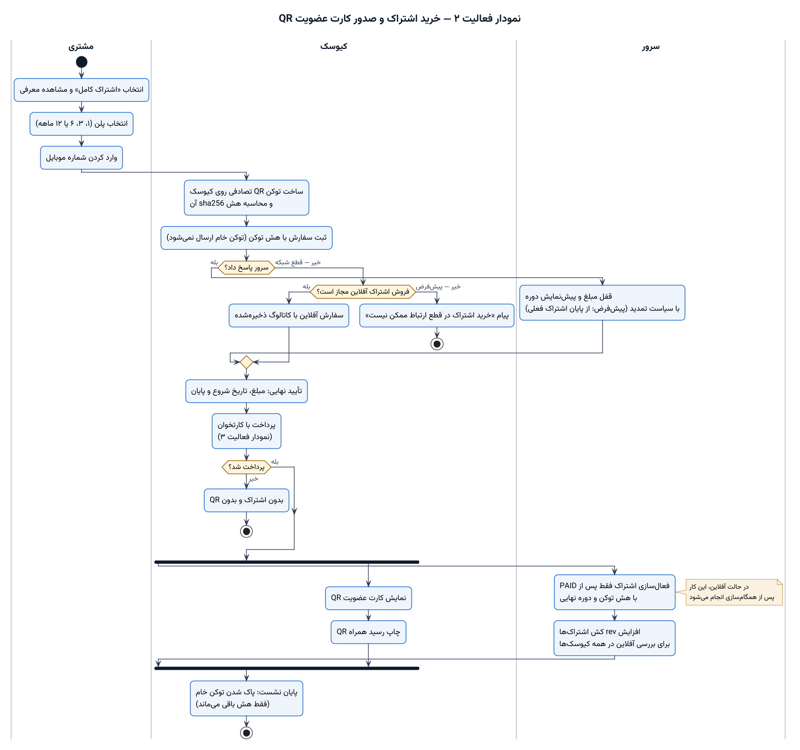
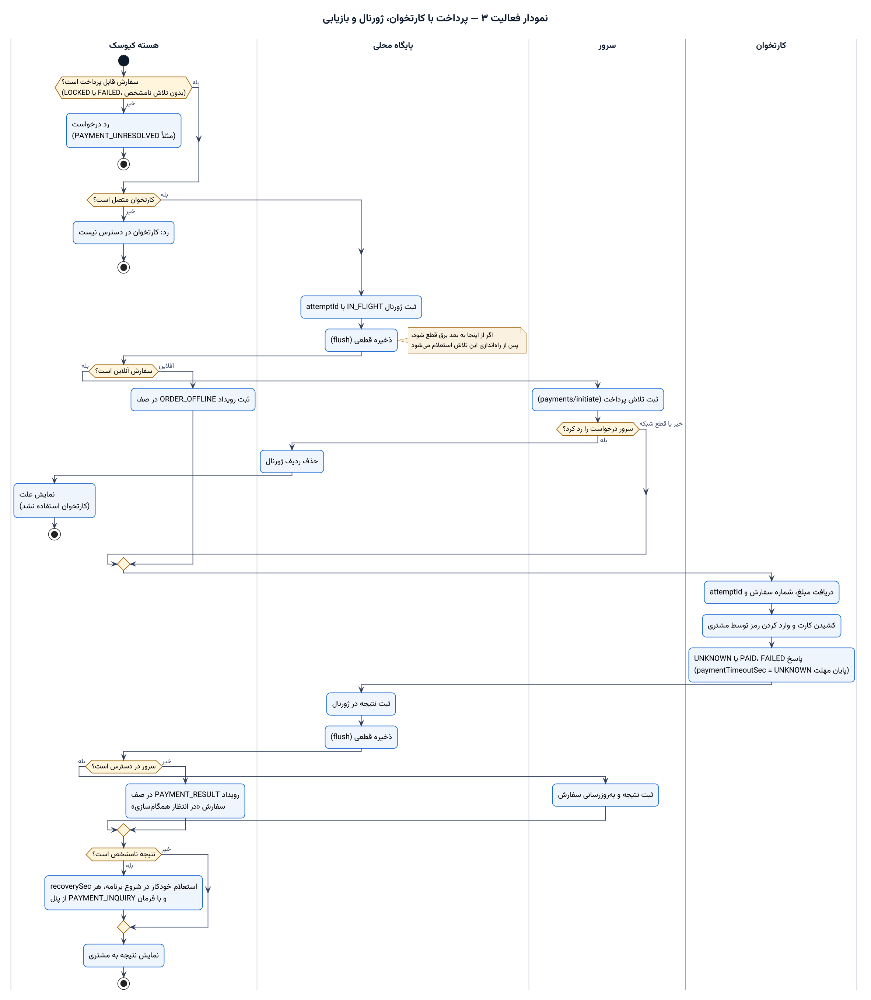
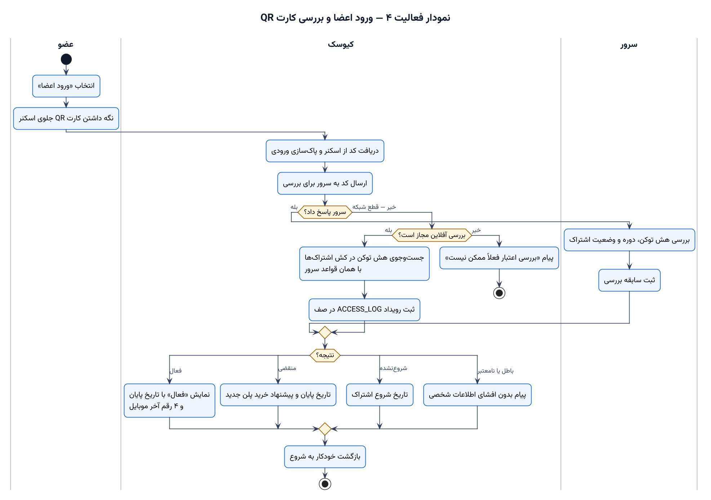
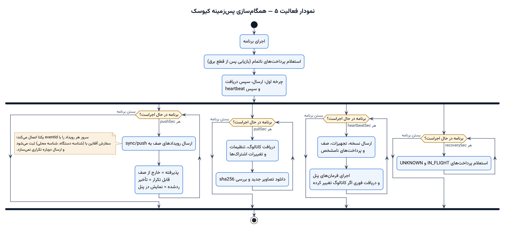
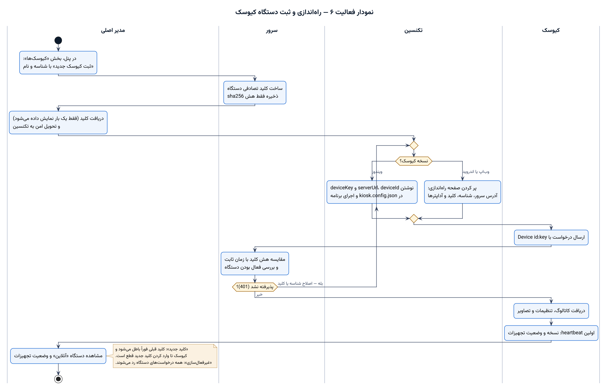
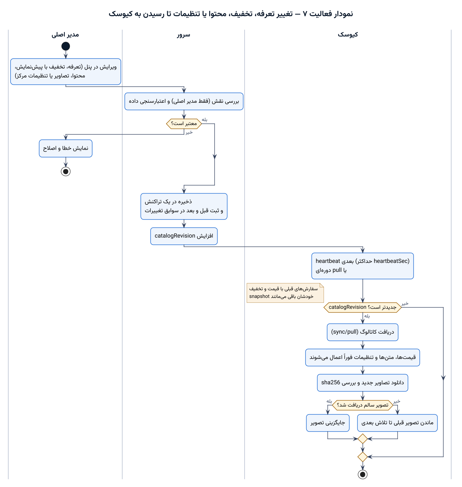
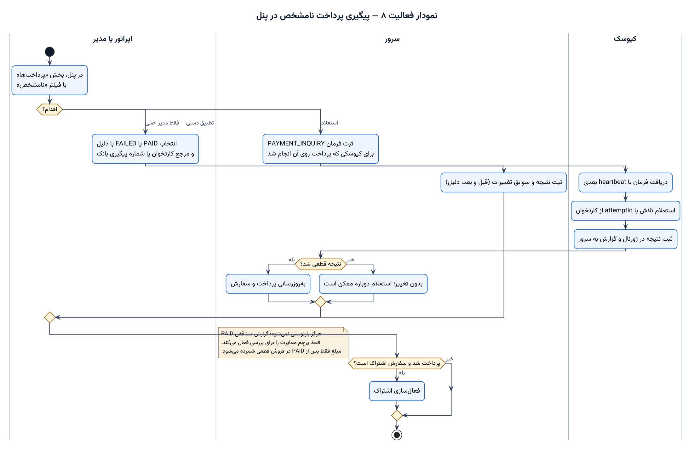
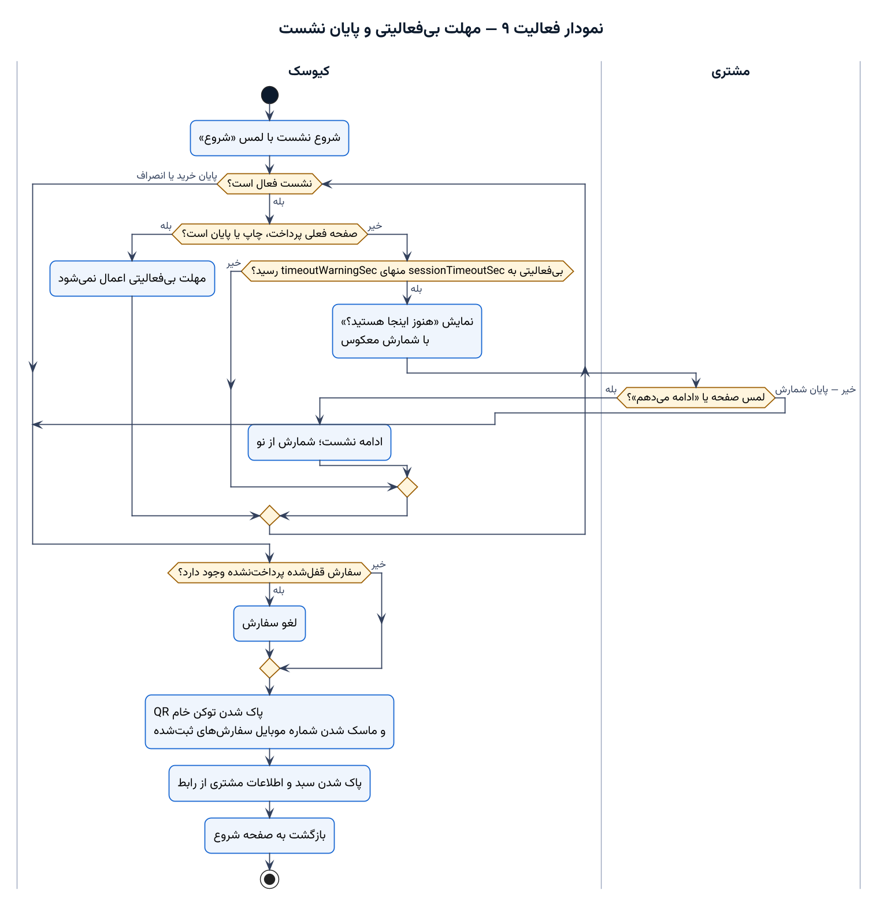

# نمودارهای فعالیت UML

نه فرایند اصلی سامانه با نمودار فعالیت (Activity Diagram) استاندارد UML. هر نمودار در ستون‌ها (swimlane) نشان می‌دهد هر کار را کدام بازیگر انجام می‌دهد: مشتری، کیوسک، سرور، کارتخوان، مدیر یا تکنسین.

| نماد | معنی در UML |
| --- | --- |
| دایره توپر | گره آغاز |
| دایره توپر با حلقه | گره پایان فعالیت |
| مستطیل با گوشه گرد | کنش (action) |
| لوزی | تصمیم یا ادغام مسیرها؛ شرط هر مسیر روی خودش نوشته شده |
| میله ضخیم | انشعاب (fork) یا پیوند (join) کارهای هم‌زمان |
| ستون با عنوان | بخش‌بندی (partition / swimlane) بر اساس بازیگر |
| برگه زرد | یادداشت |

منبع هر نمودار فایل PlantUML (`.puml`) در پوشه [`docs/uml`](uml) است. برای ساخت دوباره PNG و SVG:

```bash
pnpm docs:uml        # = bash tools/uml/render.sh
```

اسکریپت به Java 11 یا بالاتر و قلم Vazirmatn به‌صورت TTF نیاز دارد (فایل‌ها در `apps/kiosk/node_modules/vazirmatn/fonts/ttf`). PlantUML نسخه `1.2026.7` یک بار از Maven Central دانلود و با SHA-1 بررسی می‌شود.

| # | فرایند | بازیگران | فایل‌ها |
| --- | --- | --- | --- |
| ۱ | [خرید خدمات](#۱-خرید-خدمات) | مشتری، کیوسک، سرور | [PNG](uml/01-service-purchase.png) · [SVG](uml/01-service-purchase.svg) · [منبع](uml/01-service-purchase.puml) |
| ۲ | [خرید اشتراک و صدور کارت QR](#۲-خرید-اشتراک-و-صدور-کارت-عضویت-qr) | مشتری، کیوسک، سرور | [PNG](uml/02-subscription-purchase.png) · [SVG](uml/02-subscription-purchase.svg) · [منبع](uml/02-subscription-purchase.puml) |
| ۳ | [پرداخت با کارتخوان، ژورنال و بازیابی](#۳-پرداخت-با-کارتخوان-ژورنال-و-بازیابی) | هسته کیوسک، پایگاه محلی، سرور، کارتخوان | [PNG](uml/03-card-payment.png) · [SVG](uml/03-card-payment.svg) · [منبع](uml/03-card-payment.puml) |
| ۴ | [ورود اعضا و بررسی کارت QR](#۴-ورود-اعضا-و-بررسی-کارت-qr) | عضو، کیوسک، سرور | [PNG](uml/04-member-qr-check.png) · [SVG](uml/04-member-qr-check.svg) · [منبع](uml/04-member-qr-check.puml) |
| ۵ | [همگام‌سازی پس‌زمینه کیوسک](#۵-همگامسازی-پسزمینه-کیوسک) | کیوسک | [PNG](uml/05-background-sync.png) · [SVG](uml/05-background-sync.svg) · [منبع](uml/05-background-sync.puml) |
| ۶ | [راه‌اندازی و ثبت دستگاه](#۶-راهاندازی-و-ثبت-دستگاه-کیوسک) | مدیر اصلی، سرور، تکنسین، کیوسک | [PNG](uml/06-device-provisioning.png) · [SVG](uml/06-device-provisioning.svg) · [منبع](uml/06-device-provisioning.puml) |
| ۷ | [تغییر در پنل تا رسیدن به کیوسک](#۷-تغییر-تعرفه-تخفیف-محتوا-یا-تنظیمات-تا-رسیدن-به-کیوسک) | مدیر اصلی، سرور، کیوسک | [PNG](uml/07-admin-change-to-kiosk.png) · [SVG](uml/07-admin-change-to-kiosk.svg) · [منبع](uml/07-admin-change-to-kiosk.puml) |
| ۸ | [پیگیری پرداخت نامشخص در پنل](#۸-پیگیری-پرداخت-نامشخص-در-پنل) | اپراتور یا مدیر، سرور، کیوسک | [PNG](uml/08-unknown-payment-followup.png) · [SVG](uml/08-unknown-payment-followup.svg) · [منبع](uml/08-unknown-payment-followup.puml) |
| ۹ | [مهلت بی‌فعالیتی و پایان نشست](#۹-مهلت-بیفعالیتی-و-پایان-نشست) | کیوسک، مشتری | [PNG](uml/09-session-timeout.png) · [SVG](uml/09-session-timeout.svg) · [منبع](uml/09-session-timeout.puml) |

## ۱. خرید خدمات

مشتری یک یا چند خدمت از حوزه‌های مختلف را در سبد می‌گذارد و شماره موبایل می‌دهد.

- **سرور پاسخ داد:** سرور مبلغ را با تعرفه و تخفیف روز قفل می‌کند.
- **قطع شبکه:** کیوسک فقط اگر فروش آفلاین مجاز و کاتالوگ تازه باشد، سفارش `OFF-…` می‌سازد.
- **پرداخت ناموفق:** روی همان سفارش دوباره می‌شود پرداخت کرد.
- **پرداخت نامشخص:** فقط استعلام ممکن است و تلاش دوباره ممنوع است.
- **پرداخت موفق:** چاپ رسید و گزارش نتیجه هم‌زمان انجام می‌شوند (انشعاب).


## ۲. خرید اشتراک و صدور کارت عضویت QR

- توکن QR روی کیوسک ساخته می‌شود و فقط هش sha256 آن به سرور می‌رود.
- خرید اشتراک در قطع شبکه به‌طور پیش‌فرض بسته است.
- اشتراک **فقط پس از PAID** فعال می‌شود. هم‌زمان کیوسک کارت QR را نمایش می‌دهد و چاپ می‌کند.
- در پایان نشست، توکن خام از کیوسک پاک می‌شود.



## ۳. پرداخت با کارتخوان، ژورنال و بازیابی

- ردیف ژورنال `IN_FLIGHT` **پیش از روشن شدن کارتخوان** ثبت و قطعاً ذخیره می‌شود. نتیجه کارتخوان هم پیش از هر کار دیگر ذخیره می‌شود.
- اگر سرور تلاش را رد کند، کارتخوان اصلاً استفاده نمی‌شود.
- در قطع شبکه، نتیجه در صف رویداد می‌ماند.
- نتیجه نامشخص در شروع برنامه، هر `recoverySec` و با فرمان پنل استعلام می‌شود.



## ۴. ورود اعضا و بررسی کارت QR

- **سرور پاسخ داد:** سرور اعتبار را بررسی و ثبت می‌کند.
- **قطع شبکه:** اگر بررسی آفلاین مجاز باشد، کیوسک با کش اشتراک‌ها و همان قواعد سرور تصمیم می‌گیرد و سابقه را در صف می‌گذارد.
- نتیجه فقط تاریخ‌ها و ۴ رقم آخر موبایل را نشان می‌دهد.



## ۵. همگام‌سازی پس‌زمینه کیوسک

پس از بازیابی پرداخت‌های ناتمام و یک چرخه کامل، چهار حلقه هم‌زمان اجرا می‌شوند:

- ارسال صف رویداد (`pushSec`)
- دریافت کاتالوگ، تنظیمات و اشتراک‌ها (`pullSec`)
- ضربان و فرمان‌های پنل (`heartbeatSec`)
- استعلام پرداخت‌های نامشخص (`recoverySec`)



## ۶. راه‌اندازی و ثبت دستگاه کیوسک

- مدیر اصلی کیوسک را ثبت می‌کند. سرور فقط هش کلید را نگه می‌دارد و کلید یک بار نمایش داده می‌شود.
- تکنسین کلید را در `kiosk.config.json` (ویندوز) یا صفحه راه‌اندازی (وب و اندروید) وارد می‌کند.
- تا وقتی سرور شناسه یا کلید را نپذیرد (401)، این مرحله تکرار می‌شود.
- جزئیات: [تنظیمات دستگاه در README](../README.md#تنظیمات-دستگاه).



## ۷. تغییر تعرفه، تخفیف، محتوا یا تنظیمات تا رسیدن به کیوسک

- تغییر پس از بررسی نقش و اعتبارسنجی در یک تراکنش ذخیره و در سوابق تغییرات ثبت می‌شود.
- با افزایش `catalogRevision`، کیوسک در heartbeat بعدی کاتالوگ را دریافت می‌کند.
- قیمت و متن فوراً اعمال می‌شوند. تصویر فقط پس از دانلود سالم جایگزین می‌شود.



## ۸. پیگیری پرداخت نامشخص در پنل

- **استعلام** (اپراتور هم می‌تواند): فرمان `PAYMENT_INQUIRY` به همان کیوسک فرستاده می‌شود.
- **تطبیق دستی:** فقط مدیر اصلی، با دلیل و شماره مرجع.
- اگر سفارش اشتراک PAID شود، اشتراک فعال می‌شود.
- PAID هرگز بازنویسی نمی‌شود.



## ۹. مهلت بی‌فعالیتی و پایان نشست

- در صفحه‌های پرداخت، چاپ و پایان، مهلت اعمال نمی‌شود.
- در بقیه صفحه‌ها، پیش از پایان مهلت شمارش معکوس نمایش داده می‌شود.
- **پایان نشست:**
  - لغو سفارش قفل‌شده پرداخت‌نشده
  - پاک شدن توکن خام QR
  - ماسک شدن موبایل
  - پاک شدن اطلاعات از رابط


